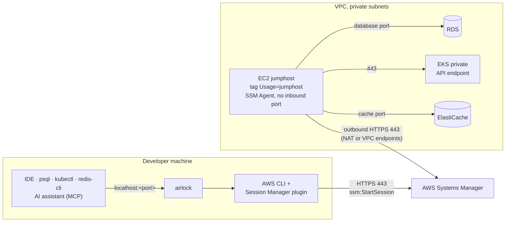

<div align="center">

# 🔐 airlock

**Reach private AWS databases, clusters and caches from your laptop, with no VPN, no SSH keys and no open ports.**

Guided SSM port forwarding to **RDS**, **EKS** and **ElastiCache** through a jumphost, with
IntelliJ data sources and a guarded **MCP server** so AI assistants can query tunneled databases.


[Features](#-features) ·
[Quick start](#-quick-start) ·
[How it works](#-how-it-works) ·
[Usage](#-usage) ·
[AI access (MCP)](#-ai-access-with-mcp) ·
[Configuration](#%EF%B8%8F-configuration) ·
[Jumphost setup](docs/jumphost-setup.md)

</div>

---

## ✨ Features

|  |  |
|---|---|
| 🧭 **Guided wizard** | Pick a recent connection, or go resource type → profile → target → review. Search every target of a profile in one list. |
| 🔑 **Passwordless databases** | RDS sign-in with short-lived AWS IAM tokens. Password and AWS Secrets Manager sign-in are available too, with an optional OS keychain. |
| 🪟 **Parallel sessions** | Open as many tunnels as you need, switch between them with a keystroke. Local ports never collide. |
| 🤖 **AI-ready** | Each database, EKS, cache, DynamoDB and S3 session serves a guarded MCP server and registers it for Claude Code and VS Code. |
| 🗄 **Direct databases** | Declare the PostgreSQL and SQL Server databases you reach without jumphost, and get the same MCP server, audit log and IDE data source. |
| 🧾 **Audited** | Every MCP call is shown live in the dashboard and written to a daily JSONL audit log. |
| 🧩 **IDE integration** | Registers the tunnel as an IntelliJ data source in `.idea/dataSources.xml`. |
| 🌍 **Region aware** | Switch region at any time from a searchable list (`paris`, `eu-west`, `japan`…). |
| 👥 **Team settings** | Share one config string with `airlock config export` / `import`. |

## 🚀 Quick start

**1. Install.** No Go needed: the installer downloads the latest release for your machine. The
repository is private, so sign in to GitHub once with the [GitHub CLI](https://cli.github.com)
(`brew install gh` or `winget install GitHub.cli`, then `gh auth login`).

macOS and Linux:

```sh
gh api repos/n2jsoft/airlock/contents/install.sh -H 'Accept: application/vnd.github.raw' | sh
```

Windows (PowerShell 7+):

```pwsh
& ([scriptblock]::Create((gh api repos/n2jsoft/airlock/contents/install.ps1 -H 'Accept: application/vnd.github.raw' | Out-String)))
```

**2. Connect.** Open a new terminal, then:

```sh
airlock                      # launch the wizard
airlock rds my-db 5432       # …or connect directly
```

Then point your tools at `localhost:5432`. That's it. Later, `airlock update` keeps it current.

<details>
<summary><b>What the installer does, and its options</b></summary>

It reads the release with `GH_TOKEN`, `GITHUB_TOKEN` or the token of the GitHub CLI, checks the
archive against the release's `checksums.txt`, then installs `airlock` to a folder you own, so
`airlock update` never needs `sudo` or an administrator terminal:

| | macOS and Linux (`install.sh`) | Windows (`install.ps1`) |
|---|---|---|
| Install folder | `~/.local/bin` | `%LOCALAPPDATA%\Programs\airlock` |
| PATH | Added to your shell profile (`.zshrc`, `.bashrc`, `.bash_profile` or fish `conf.d`) | Added to your user PATH |
| Other folder | `--dir <path>` or `AIRLOCK_INSTALL_DIR` | `-InstallDir <path>` or `AIRLOCK_INSTALL_DIR` |
| Given release | `--version <tag>` or `AIRLOCK_VERSION` | `-Version <tag>` or `AIRLOCK_VERSION` |
| Leave PATH alone | `--skip-path` | `-SkipPath` |
| Organization config ([details](#organization-config)) | `--organization-config <source>` | `-OrganizationConfig <source>` |
| Uninstall ([details](#uninstalling)) | `--uninstall`, with `--purge` for your data | `-Uninstall`, with `-Purge` for your data |

When piped, pass the options after `sh -s --`, for example `… | sh -s -- --dir /opt/bin`. In
PowerShell, add them after the script block: `& ([scriptblock]::Create(…)) -Uninstall`. From a
checkout, run `./install.sh` or `.\install.ps1` directly; if PowerShell refuses to run scripts,
run `install.cmd` instead (from `cmd` or by double-clicking it): it starts the same script without
changing your execution policy.

The installer then warns about another `airlock` left on your PATH, such as one from an earlier
`make install` or `go install` in `GOPATH/bin`, and about a missing AWS CLI or Session Manager
plugin.

Like `airlock update`, the installer adds a 🚀 to the release it installs: see
[Install tracking](#install-tracking).

</details>

<details>
<summary><b>Install a release by hand</b></summary>

Every push to `main` publishes a [GitHub release](https://github.com/n2jsoft/airlock/releases)
tagged with its [semantic version](https://semver.org/) (`vX.Y.Z`), with archives for macOS, Linux and Windows. With
the GitHub CLI, for example on an Apple silicon Mac:

```sh
gh release download -R n2jsoft/airlock -p '*darwin_arm64.tar.gz'
tar -xzf airlock_*_darwin_arm64.tar.gz airlock && mkdir -p ~/.local/bin && mv airlock ~/.local/bin/
```

</details>

<details>
<summary><b>Build from source (needs Go 1.27+)</b></summary>

From a checkout, `make install` builds to `GOBIN` (or `GOPATH/bin`); on Windows, without `make`,
run `go install ./cmd/airlock`. Without a checkout:

```sh
GOPRIVATE=github.com/n2jsoft \
  go install github.com/n2jsoft/airlock/cmd/airlock@latest
```

On Windows (PowerShell):

```pwsh
$env:GOPRIVATE = 'github.com/n2jsoft'
go install github.com/n2jsoft/airlock/cmd/airlock@latest
```

</details>

### Prerequisites

- **GitHub access** to `n2jsoft/airlock`, through the GitHub CLI (`gh auth login`) or a token in `GH_TOKEN`, to install and update airlock
- **AWS CLI v2** and the **[Session Manager plugin](https://docs.aws.amazon.com/systems-manager/latest/userguide/session-manager-working-with-install-plugin.html)** (used by `aws ssm start-session`)
- **AWS credentials and profiles** (`aws configure` or AWS SSO), with IAM permissions for the AWS API calls airlock makes, including `ssm:StartSession`.
  When a profile's credentials are missing or expired, airlock signs you in again for you (no AWS CLI needed for that): the
  dashboard steps aside while it runs, so the browser prompt, URL and code stay readable, then comes back.
  Profiles that assume a role with MFA (`mfa_serial`) are not supported yet.
- **A running jumphost** (not for DynamoDB and S3): an EC2 instance tagged `Usage=jumphost` ([configurable](#%EF%B8%8F-configuration)) in each account and region you connect to. See [Setting up a jumphost](docs/jumphost-setup.md).

## 🛰 How it works



1. **Discover.** airlock finds the target with the AWS APIs (`rds describe-db-instances`,
   `eks describe-cluster`, `elasticache describe-*`) and the jumphost with `ec2 describe-instances`,
   filtered on the jumphost tag.
2. **Tunnel.** It starts `aws ssm start-session` with the `AWS-StartPortForwardingSessionToRemoteHost`
   document. Systems Manager relays the traffic to the jumphost's SSM Agent, which opens the
   connection to the target's endpoint inside the VPC.
3. **Connect.** Your tools connect to `localhost:<port>`.

> [!NOTE]
> Nothing is exposed to the internet. The jumphost has no public IP and no inbound rule; it only
> opens outbound connections to Systems Manager.

## 🧭 Usage

```sh
airlock                              # interactive wizard
airlock rds my-db 5432               # tunnel to an RDS instance on localhost:5432
airlock eks my-cluster 15432         # tunnel to a private EKS API endpoint
airlock elasticache my-cache 6379    # tunnel to an ElastiCache cluster
airlock dynamodb eu-west-3         # DynamoDB tables of a region, for the AI assistant (MCP)
airlock s3                         # S3 buckets of a profile, for the AI assistant (MCP)
airlock direct legacy-billing        # a direct database declared with airlock connection add
airlock docker pg                    # a database running in a local Docker container
airlock rds my-db 5432 --db-user app_ro
```

<details>
<summary><b>All flags</b></summary>

| Flag | Meaning |
|---|---|
| `-p`, `--profile` | AWS profile to use (the wizard asks when omitted). `--aws-profile` is an alias. |
| `--region` | AWS region (defaults to `AWS_REGION`, then the profile's region) |
| `--db-user` | Database or cache user for AWS IAM authentication |
| `--db-secret` | Secrets Manager secret (ARN or name) holding the database or cache password |
| `--no-ide-datasource` | Do not register the connection in `./.idea/dataSources.xml` |
| `--no-mcp` | Do not serve the MCP server |
| `--mcp-allow-writes` | Let the MCP server modify data (databases, caches, DynamoDB tables and S3 objects) |
| `--jumphost-tag` | Tag of the jumphost instance, as `Key=Value` |
| `--read-only-secret-tag` | Tag of the read-only SQL Server secrets, as `Key=Value` |
| `--mcp-server-prefix` | Prefix of the MCP server names |

</details>

<details>
<summary><b>Shell completion</b></summary>

`airlock completion bash|zsh|fish|powershell` prints the completion script. It completes the
resource type, the targets you connected to (filtered by `--profile` and `--region` when given),
the local port they last used, the AWS profiles and the regions, all without calling AWS.

```sh
airlock completion zsh > "${fpath[1]}/_airlock"      # zsh
airlock completion bash > ~/.local/share/bash-completion/completions/airlock   # bash
airlock completion fish > ~/.config/fish/completions/airlock.fish              # fish
```

</details>

`airlock version` prints the release the binary was built from, such as `v1.2.0`. A build from a
later commit prints a Go pseudo-version, such as `v1.2.1-0.20261001120000-b50fc20abcde`, and `dev`
when run with `go run`.

Each push to `main` releases a version bumped by [semantic-release](https://semantic-release.gitbook.io/)
from its pull request title, a [conventional commit](https://www.conventionalcommits.org/): `feat`
bumps the minor, a breaking change (`feat!:`, or `BREAKING CHANGE:` in the body) the major, any
other type (`fix`, `docs`, `chore`…) the patch. A title that is not a conventional commit releases
nothing.

### Language

airlock speaks English and French. By default it follows the system: `LC_ALL`, `LC_MESSAGES`,
then `LANG`, else the macOS or Windows display language; any other language gives English.

```sh
airlock config set language fr     # always French
airlock config set language auto   # back to the system's
LANG=en_US.UTF-8 airlock           # English for one run (when language is auto)
```

The setting is personal: `airlock config export` never shares it. The daemon reads it when it
starts: run `airlock daemon restart` after a change. MCP tools, their answers and the errors AI
agents read stay in English; logs too.

### Updating

`airlock update` installs the latest release in place of the running binary when it is newer than
your build, after checking the download against the release's `checksums.txt`:

```sh
airlock update           # install the latest release when it is newer
airlock update --check   # only tell whether a newer release exists
airlock update --force   # install the latest release even over a newer or unreleased build
```

The repository is private, so airlock reads releases with `GH_TOKEN`, `GITHUB_TOKEN` or the token
of the GitHub CLI (`gh auth login`). When airlock lives in a folder you cannot write, such as
`/usr/local/bin`, run `sudo GH_TOKEN="$(gh auth token)" airlock update` (sudo drops your token) or
reinstall with the [installer](#-quick-start), which installs to a folder you own; on Windows, run
it from an administrator terminal or reinstall with `install.ps1`.

Once a day, in the background, the connect command checks for a newer release; the next launch
then shows `update available` in the wizard, or a line on stderr for a direct connection. Set
`AIRLOCK_NO_UPDATE_CHECK` to any non-empty value (`AIRLOCK_NO_UPDATE_CHECK=1`) to turn the check off.

#### Install tracking

After installing a release, the installer and `airlock update` add a 🚀 reaction to that release on
GitHub, with your GitHub account. The reactions of a release then tell who installed it, once per
account. A reaction never holds an install back: when the token cannot write reactions or GitHub
does not answer within 5 seconds, airlock carries on silently. Set `AIRLOCK_NO_TRACKING` to any
non-empty value (`AIRLOCK_NO_TRACKING=1`) to skip it. To list who installed a release:

```sh
gh api repos/n2jsoft/airlock/releases/tags/<tag> --jq .id   # the release id
gh api repos/n2jsoft/airlock/releases/<id>/reactions --jq '.[] | select(.content == "rocket") | .user.login'
```

### Uninstalling

`airlock uninstall` removes airlock however it was installed (installer, `make install` or
`go install`). It lists what it removes and what it keeps, then asks before changing anything:

```sh
airlock uninstall           # remove the binary and the PATH entry its installer added
airlock uninstall --purge   # also remove your settings, history, logs and saved passwords
airlock uninstall --yes     # do not ask (required without a terminal)
```

| | Removed | With `--purge` |
|---|---|---|
| The airlock binary | ✅ | ✅ |
| The installer's PATH entry: the block in your shell profile, or the Windows user PATH entry and folder | ✅ when the folder holds nothing else | ✅ |
| `~/.config/airlock` (`%AppData%\airlock`): settings, the gateway token (`gateway-token`), direct databases, recent connections, MCP query logs, kubeconfigs | | ✅ |
| Database passwords saved in the OS keychain | | ✅ |

The MCP gateway entry in the user-level files of your AI clients (`~/.claude.json`…) is removed too.
The IntelliJ data sources airlock added to your projects' `.idea/dataSources.xml` stay. On
Windows, `airlock.exe` is deleted right after airlock exits, since Windows cannot delete a running
program; quit any other airlock first. The installers' `--uninstall` / `-Uninstall` (and `--purge`
/ `-Purge`) run the same command, and still remove an airlock too old to have it.

### The wizard

The wizard opens on your **recent connections**, most recently used first. Picking one checks that
the target still exists and opens its review step prefilled. Without any recent connection, it opens
on the resource type step.

| Key | Action |
|---|---|
| any letter · `/` | Filter recent connections by name, type, profile or region: type right away, or press `/` first when the name starts with a shortcut letter (`n`, `s`, `d`, `q`, `j`, `k`…) |
| `n` | Start a new connection (resource type → AWS profile → target → review) |
| `s` | Search a target: choose a profile, then pick among all its RDS, EKS, ElastiCache, DynamoDB and S3 targets in one list |
| `d` | Forget a recent connection |
| `r` | Switch region (on the resource type, target and search steps) |
| `esc` | Go back one step (from the first step of a wizard opened with `n`, back to the sessions); while AWS answers, cancel |
| `?` | List the keys of the current step |

- `--profile` and `--region` filter the recent connections and skip the profile question.
- Target types that cannot be listed during a search are named in a warning.
- A recent connection whose profile no longer exists asks for another one. A profile that reaches a
  different AWS account than the one the connection was saved in is refused, since same-named targets
  often exist in several accounts.

### Regions

The wizard never asks for a region up front: the header shows the current one, resolved in this
order:

`--region` → `AWS_REGION` → the profile's configured region → `aws.defaultRegion`

Without any of them, the header shows `region none` and the wizard opens the region list before it
looks for targets. Non-interactive runs fail and name the settings to add. Press `r` to switch region
from a searchable list (by code, city or country). Switching on the target step reloads the targets,
or the search, for the new region.

### Database sign-in

The wizard ends on a **review step** that summarizes the connection. You can edit the local port,
the sign-in method and the database user there before connecting.

| Key | Action |
|---|---|
| `tab` | Switch field |
| `←` `→` · `space` | Change the **Sign-in** method |
| `enter` | Connect (on the Secret field: search the secrets) |

The **Sign-in** selector offers up to four methods, depending on the target:

| Method | Offered when |
|---|---|
| **IAM token** | The instance has IAM authentication enabled. Default when offered. |
| **Auto** | SQL Server only: the tagged read-only secrets, or the master user secret with MCP writes. |
| **Password** | PostgreSQL, Aurora PostgreSQL and SQL Server targets, with the MCP server on (no `--no-mcp`). |
| **Secrets Manager** | Same as Password. |

Password and Secrets Manager are offered only where airlock itself uses the credentials, that is for
the MCP server. Elsewhere (MySQL, or `--no-mcp`) only IAM token is shown when enabled, and your IDE
asks for the password as before.

- **IAM token.** airlock signs in without a password, generating short-lived AWS IAM tokens. The user
  is prefilled with `--db-user`, then the user saved for that database, then the `modules.sql.defaultDbUser` of
  its engine.
- **Password.** Enter a user and its password. It stays in memory for the MCP server; the IntelliJ
  data source switches to user & password (the IDE asks for the password), and the restart command
  falls back to IAM sign-in. The **Remember** toggle (off by default) stores the password in the OS
  keychain, and the next connection prefills it, masked.
- **Secrets Manager.** Press `enter` on the **Secret** field to search every secret of the account
  and region. The secrets linked to the instance come first: tagged `DBInstanceArn`, the RDS master
  user secret, or a name containing the instance name. The secret is either RDS JSON (`username` and
  `password`) or plain text (then fill the **User** field). It is read before the tunnel opens, so an
  unreadable secret fails fast, and the MCP server reads it again after the database rejects the
  password, which covers rotation. From the CLI, `--db-secret <arn|name>` selects it and wins over the
  saved choice; the restart command of such a session carries `--db-secret`.
- The user feeds the connection hints, the IntelliJ data source, the MCP server and the restart
  command. Instances without IAM authentication or MCP support only show the port.

```sh
airlock rds my-db 5432 --db-secret prod/app-user
```

#### Sign-in check

Once the tunnel is up, airlock checks the sign-in with `SELECT 1` and shows the result on the
**Sign-in** row of the session. With **Auto** on SQL Server, it looks for the instance's read-only
secrets (tag `modules.sql.readOnlySecretTag`), with or without a `dbname`: one is used right away, several are
offered in a dialog (`1`–`9` or `enter`; `esc` decides later). A working secret becomes the session's
sign-in (MCP server, IntelliJ data source, reconnect command) and is remembered in `saved-connections.json`
as a Secrets Manager sign-in, its ARN and user only, so the next connection skips the choice. When a
check fails, the tunnel stays open and the other credentials are offered; if the database rejects a
remembered secret, it is forgotten and the sign-in falls back to **Auto**. Press `a` to choose or
check again. The master user secret is never offered; Auto with MCP writes and engines airlock does
not query (MySQL) are not checked.

#### The OS keychain

With **Remember**, the password is stored under the service `airlock` in the macOS Keychain, the
Windows Credential Manager or the Linux Secret Service. It is forgotten when you turn **Remember**
off, when the database rejects it, or when you forget the connection from the recent list (`d`).
Without an OS keychain (a headless Linux, for example), the toggle is not offered and the password is
asked every time. A keychain failure never blocks the connection: it appears as a `Warning:` line in
the session log.

> [!WARNING]
> On macOS, airlock reaches the Keychain through `/usr/bin/security`, so the item trusts that tool,
> not airlock. Another process running as the same user can read it without a prompt. It is safer
> than a plaintext file, but it is not per-application isolation.

#### IAM permissions

Secrets Manager sign-in needs `secretsmanager:ListSecrets` and `secretsmanager:GetSecretValue`, plus
`kms:Decrypt` when the secret uses a customer-managed KMS key.

> [!TIP]
> airlock remembers each connection per target (AWS account, region, resource type and name), so
> several profiles that reach one account share it. It stores the last profile and local port, plus the
> user, sign-in method, secret ARN, keychain flag and MCP write access for databases, in
> `~/.config/airlock/saved-connections.json` (`$XDG_CONFIG_HOME/airlock` when set), next to the
> direct databases. A saved port that is already in use falls back to a free one, and `--db-user` /
> `--db-secret` / `--mcp-allow-writes` still win. **`saved-connections.json` never holds a password.**
> `airlock connection list` shows every saved connection; `airlock connection remove <name>` forgets
> one (`rds/my-db`, or its full key when several regions or accounts have one).

### Kubernetes (EKS)

Each EKS session gets its own kubeconfig, written to `~/.config/airlock/kube/`
(`$XDG_CONFIG_HOME/airlock/kube` when set) and removed when the session stops. Its only context
points at the tunnel, checks the certificate against the real cluster endpoint (`tls-server-name`)
and signs in with `airlock eks-token`, with the session's profile and region. Your own
`~/.kube/config` is never touched. A kubeconfig left by an airlock that was killed is removed at
the next start; those of another running airlock are kept.

```sh
export KUBECONFIG=~/.config/airlock/kube/airlock-<profile>-<region>-<cluster>.json
kubectl get namespaces    # k9s, Lens and other clients read it too
```

The session log shows the exact path, and the dashboard's `Kube` row the `KUBECONFIG` value. To
keep your own context of the cluster instead, point it at the tunnel:
`kubectl --server https://localhost:<port> --tls-server-name <endpoint host> get namespaces`.

### Direct databases

Some PostgreSQL and SQL Server databases need no jumphost: you reach them directly (VPN, peering
or a public endpoint) with a user and a password. Declare them once, and airlock opens them like
any other connection, without tunnel nor AWS profile: same MCP server (`airlock-<name>`), audit
log, IntelliJ data source, sign-in check and environment badge.

```sh
airlock connection add legacy-billing --engine sqlserver --host billing.db.internal --user mcp_ro --environment prod
airlock connection add analytics --engine postgres --host 10.0.4.12 --database events --user reader --tls verify
airlock connection list                # every saved connection, with its ENV: direct and through a jumphost
airlock connection edit analytics --port 6432
airlock connection test legacy-billing # signs in and runs SELECT 1
airlock direct legacy-billing          # opens it in the dashboard
airlock connection remove analytics    # also forgets its saved choices and keychain password
```

The dashboard does the same: pick **Direct database** (`4`) on the Type step, then `a` adds a
database, `e` edits the selected one and `x` deletes it. Opened direct databases show up in the
recent connections as `direct · host:port`; `d` forgets one.

| Flag | Default | Meaning |
|---|---|---|
| `--engine` | required | `postgres` or `sqlserver` |
| `--host` | required | Host name or IP address, without scheme or port |
| `--port` | 5432 / 1433 | Port of the database |
| `--database` | `postgres` / the login's default | Database opened when none is named |
| `--user` | required | User signing in with its password |
| `--tls` | `require` | `require` encrypts without checking the certificate; `verify` also checks it, against the host name, with your system's trusted CAs; `disable` sends everything in clear text, for local databases only |
| `--environment` | none | Environment of the environments setting; `prod` is production |

`--environment ""` clears the environment. The production environment is always saved as `prod`,
whatever your setting calls it, and `airlock connection import` warns about environments missing from
your `environments` setting.

`airlock connection edit` changes only the flags you give; any change but `--environment` (renaming it with
`--name`, or another engine, host, port, database, user or TLS mode) forgets the password remembered
before, so that it never reaches another server or user. The dashboard's form and `airlock connection
import` do the same.

Definitions live in `~/.config/airlock/saved-connections.json`, next to `config.json`. Passwords
never do: you type the password on the review step, and **Remember** keeps it in the OS keychain.
`airlock direct <name>` without a terminal needs it there. `airlock db …` still works as an alias
of `airlock connection …`.

**Sharing.** `airlock connection export [name…]` prints the definitions as one `airlockdb1:` string, without
any password. Without names, a terminal first lists every database, all selected: `space` unchecks
the ones to leave out, `a` toggles them all, `enter` prints the string. The list is drawn on stderr, so
`airlock connection export | pbcopy` still works; `--all`, or no terminal, exports them all without
asking. `airlock connection import <string>` lists every database it adds (`+`), changes (`~`, field
by field) or keeps (`=`), then asks before writing; `--yes` skips the question. A database whose
connection changes is marked `(remembered password will be forgotten)`: its password is forgotten
once the import is applied. A name held by an entry airlock cannot read is marked `(replaces an
invalid entry)`, and the password remembered for the user it names is forgotten too. An import never
removes a database.

**Upgrading.** The first run of this version moves `databases.json` and `connections.json` into
`saved-connections.json` and keeps the old files as `databases.json.bak` and `connections.json.bak`.
Remembered keychain passwords are kept. A daemon started before the update keeps its old version
until `airlock daemon restart`.

> [!WARNING]
> Read-only access to a direct **SQL Server** database rests on the permissions of its user: there
> are no read-only secrets as on RDS, and SQL Server has no read-only transaction to fall back on.
> Declare a user that can only read, unless you mean to allow writes.

### Docker databases and caches

airlock finds the PostgreSQL, SQL Server, Redis and Valkey containers running locally in Docker and
signs in with the credentials of their environment or command: nothing to declare, nothing saved.

```bash
docker run -d --name pg -e POSTGRES_PASSWORD=secret -p 55432:5432 postgres:16
airlock docker pg
```

A cache works the same way:

```bash
docker run -d --name cache -p 6379:6379 redis:7
airlock docker cache
```

- `airlock docker` opens the dashboard on the list of database and cache containers; the Type step also
  offers a **Docker database** card.
- User, password and database come from `POSTGRES_USER` / `POSTGRES_PASSWORD` / `POSTGRES_DB`
  (Bitnami: `POSTGRESQL_*`), or `sa` and `MSSQL_SA_PASSWORD` / `SA_PASSWORD` for SQL Server. A
  password given as a `*_FILE` secret is typed in the dashboard.
- Redis and Valkey: container port 6379, user `default`; the password comes from `--requirepass`
  in the container command, else `REDIS_PASSWORD` / `VALKEY_PASSWORD`, else there is no auth.
  Agents see them as `type: "docker-cache"` with the `cache_*` tools. Not supported yet: ACL
  users, Redis Cluster, TLS, a password only in a mounted `redis.conf` (the dashboard asks for it
  once refused), a command given as one shell string.
- The engine port must be published (`-p <host-port>:5432`); TLS is off.
- The active Docker context must be the local daemon: published ports are reached on
  `127.0.0.1`, so remote contexts are not supported.
- MCP writes are on by default. Without a terminal, `--mcp-allow-writes=false` turns them off; in
  the dashboard, the `MCP` toggle of the review does. Agents list the containers with `list_targets` and open them with `open_session`
  (`type: "docker"`, or `"docker-cache"`) under the usual agent policy.

### Parallel sessions

While a session runs, press `n` to open another one, with any profile and any resource. Running
sessions stay active, and the start screen marks recent connections that are already open: `enter`
on one of them switches to its session instead of opening a second one.

| Key | Action |
|---|---|
| `n` | Open another connection |
| `tab` · `←` `→` · `1`–`9` | Switch between sessions |
| `m` | Switch the bottom panel between logs and MCP calls (sessions with an MCP server) |
| `↑` `↓` · `pgup` `pgdn` | Scroll the logs; scrolling up pauses them |
| `g` · `home` / `G` · `end` | Jump to the start of the logs / back to the live tail |
| `x` | Stop the selected session, or close it once ended |
| `r` | Restart the selected ended session: same target, local port and sign-in |
| `c` | Copy the local address, the IAM token command, the reconnect command, the `KUBECONFIG` export or the last MCP call |
| `a` | Choose the database credentials of the session, or check them again after a failure |
| `p` | Show the database passwords read from Secrets Manager: the picked secret, or the read-only secret of each database (never the master one). They are read again each time; `c` or `1`–`9` copies one, `esc` hides them |
| `esc` | Cancel a connection being prepared |
| `?` | List every key |
| `q` · `ctrl+c` | Stop all sessions and quit, after a confirmation (`y` / `n`, or `ctrl+c` again) |

`c` copies to the system clipboard (`pbcopy`, `xclip`, `wl-copy`…). Over SSH, or without such a
tool, it asks the terminal to copy through OSC 52, which most terminals support (iTerm2, kitty,
WezTerm, Ghostty, Windows Terminal, tmux with `set-clipboard on`), but not macOS Terminal.

A session that ends, on its own or with `x`, stays in the dashboard with its logs until you close it,
restart it or quit.

**Automatic reconnection.** A session that worked and then drops on its own (SSM idle timeout,
network loss, laptop sleep) reconnects in the background, in the same slot, on the same local port
and with the same sign-in, so your tools keep working. Its card shows `Retry in 5s`, then
`Reconnecting`. Attempts wait 2 s, 5 s, 15 s, 30 s, then 1 min, and stop after the fifth in a row;
a session that then runs for a minute gets fresh attempts. `r` reconnects now, `x` closes the
session instead.

- A session stopped with `x`, or that never listened (its settings are likely wrong), is not
  reconnected.
- A reconnection never signs in: nobody may be there to answer the browser. When the AWS
  credentials have expired, it stops and asks you to press `r`, which signs in again.

- **Ports never collide.** The suggested port skips ports used by other sessions or other local
  processes (a second `5432` RDS gets `5433`). A busy port requested explicitly is rejected.
- **No duplicates.** Connecting twice to the same target (same type, name, profile and region; S3 has one session per profile, whatever its region) is
  refused.

## 🤖 AI access with MCP

For **RDS PostgreSQL** and **SQL Server** sessions, **direct databases**, **EKS** clusters and
**Redis / Valkey ElastiCache** caches, **DynamoDB** tables and **S3** buckets, airlock serves an MCP server on
`127.0.0.1` for as long as the session runs, so AI assistants can explore them: through the tunnel,
straight at the server for direct databases, or through the AWS API for DynamoDB and S3.

**Database tools**

| Tool | Description |
|---|---|
| `list_databases` | List the databases of the instance |
| `list_tables` | List the tables of a database |
| `describe_table` | Show the columns of a table |
| `query` | Run a single read-only `SELECT` / `WITH` (max 1000 rows, 30 s timeout) |
| `query_plan` | SQL Server only: execution plan of a single read-only `SELECT` / `WITH`, summarized (operators with estimated and actual rows, costs, seeks, predicates, warnings, missing indexes, parameter values) with the `STATISTICS IO` and `TIME` output. See below. |
| `execute` | Run a statement that modifies data. **Only with `--mcp-allow-writes`.** |

`query_plan` has two modes:

- `actual` (default) runs the statement in a transaction always rolled back, with `SET STATISTICS XML, IO, TIME ON`.
  A parameterized statement is passed as applications send it: `parameters` takes the declaration
  (`@p0 int, @p1 nvarchar(6)`) and `values` one value per parameter, and the statement runs through
  `sp_executesql`, so the plan is compiled for the same types and sniffed values as the application's.
- `estimated` only compiles the statement (`SET SHOWPLAN_XML ON`). It takes no parameters: SQL Server does
  not compile the statement of `sp_executesql` without running it.

`include_xml` also returns the raw showplan, to save as a `.sqlplan` file and open in SSMS. The login
needs the `SHOWPLAN` permission in the database.

**Kubernetes tools (EKS, always read-only)**

| Tool | Description |
|---|---|
| `list_namespaces` | List the namespaces and their phase |
| `list_resource_types` | List the resource types of the cluster, custom resources included |
| `list_resources` | List objects of one type, summarized (status, ready, restarts, age…), with label and field selectors (max 500) |
| `get_resource` | Show one object as JSON |
| `pod_logs` | Read the last lines of a container's logs (max 2000 lines) |
| `list_events` | List recent events, newest first, optionally of one object (max 500) |

Lists and logs are cut at 256 KiB, with a `truncated` flag. `list_events` sorts the first 5000
events the API returns (it does not sort them); on busier clusters its reply carries a `note`
saying so: narrow with a namespace, kind or name.

The server signs in with an EKS token presigned by the AWS SDK, as your IAM identity: what it can read is what the
cluster's RBAC grants you (EKS access entry or `aws-auth`). **Secret values are never returned**:
names, types and keys are, every value reads `<redacted>`. `--mcp-allow-writes` does not apply.

**Cache tools (Redis OSS and Valkey ElastiCache)**

| Tool | Description |
|---|---|
| `info` | Show `INFO` sections (server, memory, keyspace, stats, replication by default) and the number of keys |
| `scan_keys` | Find keys with `SCAN` (never `KEYS`), with their type and TTL (max 1000 per call) |
| `get_key` | Read a key of any type (string, hash, list, set, sorted set, stream), with TTL and memory usage |
| `command` | Run one read command (`GET`, `HGET`, `LRANGE`, `ZRANGE`, `TTL`, `XRANGE`, `SLOWLOG GET`…) |
| `execute` | Run one command that modifies data. **Only with `--mcp-allow-writes`.** `FLUSHALL`, `FLUSHDB`, `KEYS`, `CONFIG`, scripts, blocking, Pub/Sub, replication and connection-state commands stay refused. |

Replies of `get_key`, `command` and `execute` are capped: strings and the items of collections are
cut at 64 KiB, arrays at 1000 items, and items stop being added once a reply reaches 256 KiB, with
a `truncated` flag.

The server signs in the way the cache asks, detected from the ElastiCache API:

| Cache | Sign-in |
|---|---|
| No AUTH token, no user group | none |
| AUTH token | password (user `default`), typed in the wizard or read from Secrets Manager (`--db-secret`) |
| RBAC user group | AWS IAM (`--db-user <user id>`, the wizard suggests the IAM users), a password, or Secrets Manager |

AWS IAM tokens are signed by airlock with your profile's credentials (it needs
`elasticache:Connect` on the cache and the user; the wizard's suggestions also use
`elasticache:DescribeUserGroups` and `elasticache:DescribeUsers`). TLS is used when the cache
encrypts in transit, always for serverless caches. With cluster mode enabled, only the shard behind
the tunnel is reachable: keys of other shards answer `MOVED`. Memcached sessions stay plain tunnels.

**DynamoDB tools**

| Tool | Description |
|---|---|
| `list_tables` | List the tables of the region |
| `describe_table` | Keys, indexes, billing mode, item count and TTL of a table |
| `get_item`, `query`, `scan` | Read items (replies are capped, with a `truncated` flag) |
| `put_item`, `update_item`, `delete_item` | Modify items. **Only with `--mcp-allow-writes`.** |

A DynamoDB session is the region of a profile: no tunnel, no jumphost, no port. The tools run with
your profile's credentials, so the profile needs `dynamodb:ListTables`, `dynamodb:DescribeTable`,
`dynamodb:DescribeTimeToLive`, `dynamodb:GetItem`, `dynamodb:Query` and `dynamodb:Scan`, plus
`dynamodb:PutItem`, `dynamodb:UpdateItem` and `dynamodb:DeleteItem` for `--mcp-allow-writes`. No SSM
permission is needed, and `--no-mcp` is refused for DynamoDB (the MCP server is all it does).

**S3 tools**

| Tool | Description |
|---|---|
| `list_buckets` | List the buckets of the account, with their region |
| `list_objects` | List one level of a bucket under a prefix, or every key with `recursive` |
| `head_object` | Size, type, date, ETag, storage class and user metadata of an object |
| `get_object` | Read an object: text in 256 KB slices, PNG, JPEG, GIF, WebP and PDF up to 3.75 MB, the metadata only for other binaries |
| `put_object`, `delete_object` | Write a text object (with `if_none_match` / `if_match`) or delete one. **Only with `--mcp-allow-writes`.** |

An S3 session is every bucket of a profile, in every region: no tunnel, no jumphost, no port. The
tools run with your profile's credentials, so the profile needs `s3:ListAllMyBuckets` (to open the
session), `s3:ListBucket` and `s3:GetObject` (`s3:GetObjectVersion` with `version_id`, and
`kms:Decrypt` for SSE-KMS objects), plus `s3:PutObject` and `s3:DeleteObject` for
`--mcp-allow-writes`. Compressed objects (`Content-Encoding: gzip`) and SSE-C objects are not read.
`--no-mcp` is refused for S3.

**Registration.** The server is registered as `<prefix>-<profile>-<instance>` for a database,
`<prefix>-<profile>-<cluster>-eks` for an EKS cluster and `<prefix>-<profile>-<cache>-cache` for a
cache, `<prefix>-<profile>-dynamodb-<region>` for DynamoDB and `<prefix>-<profile>-s3` for S3 (e.g. `airlock-dev-platform-eks`, `airlock-dev-sessions-cache`), so resources of the same
name never share one, in the configuration of the AI clients chosen by `mcp.clients` (or
`--mcp-clients`):

| Client | Name | Project file (`<client>`) | User file (`<client>:user`) | Detected by `auto` when |
|---|---|---|---|---|
| **Claude Code** | `claude` | `.mcp.json` | `~/.claude.json` (`$CLAUDE_CONFIG_DIR/.claude.json` when set), and Claude Desktop's `claude_desktop_config.json` | `.mcp.json` exists (`.claude/` alone is not enough) |
| **VS Code** | `vscode` | `.vscode/mcp.json` | `mcp.json` of the VS Code user settings directory | `.vscode/` exists |
| **Codex** | `codex` | `.codex/config.toml` | `~/.codex/config.toml` (`$CODEX_HOME/config.toml` when set) | `.codex/` exists |
| **Cursor** | `cursor` | `.cursor/mcp.json` | `~/.cursor/mcp.json` | `.cursor/` exists |
| **Gemini CLI** | `gemini` | `.gemini/settings.json` | `~/.gemini/settings.json` | `.gemini/` exists |

`mcp.clients` is `auto` by default: the project files of the clients the working directory uses.
For Claude Code, that means `.mcp.json` is only updated when it already exists: create it (`{}`)
or select `claude` to have airlock write it.
Otherwise it lists clients, comma-separated, each written in its project file, or in its user file
with `:user`. The user file serves every project, wherever airlock runs. `auto` can be combined with
the list, and `none` registers nothing:

```sh
airlock config set mcp.clients claude:user,codex   # Claude Code everywhere, Codex in the current project
airlock config set mcp.clients auto,codex:user     # detected project clients, plus Codex everywhere
airlock --mcp-clients none                        # this run only: register nowhere
```

`claude:user` also registers the servers in **Claude Desktop** when it is installed:
`claude_desktop_config.json` in `~/Library/Application Support/Claude` (macOS) or `%APPDATA%\Claude`
(Windows). Claude Desktop only launches stdio servers, so its entry runs `airlock mcp-proxy <url>`,
which relays the server with the token in `AIRLOCK_MCP_TOKEN`. Claude Desktop reads that file at
startup: restart it to see a server added while it runs.

A client chosen explicitly gets its project file even when its directory does not exist yet. Project
files are never written when the working directory is your home directory: use `:user` there. Each
file is edited in place: the other servers and settings are kept. JSON files must be plain JSON,
without comments. Codex's TOML keeps its comments.

The entry is removed when the session stops. The prefix comes from `mcp.serverPrefix` (default `airlock`)
and is not repeated for profiles that already start with it: prefix `team` with profile `team-prod`
gives `team-prod-<instance>`. A red `WRITES` badge flags the sessions whose server can modify
data, in the sidebar and the compact pills. The dashboard's `MCP` row shows `read-only` or
`WRITES ENABLED`, the server name, its URL and the files it was written to. When no file was
written, it also shows the bearer token so you can configure a client by hand.

> [!IMPORTANT]
> Claude Code reads `.mcp.json` at startup and asks you to approve new project servers. If you open
> a session while Claude Code is already running, use `/mcp` to reconnect. Codex only loads a
> project's `.codex/config.toml` once you trust the project, and reads its servers at startup.

> [!WARNING]
> Claude Code rewrites `~/.claude.json` while it runs, so an entry written in it by `claude:user`
> can be lost if Claude Code saves that file at the same moment. Prefer the project file when
> Claude Code is open.

**Gateway (daemon mode).** With `"mode": "daemon"`, the daemon also serves the **gateway**: one MCP
server on `http://127.0.0.1:7821/mcp` (`mcp.gateway.port`), registered as `airlock` (the
`mcp.serverPrefix`) in the **user-level** files of the clients of `mcp.clients` (`claude:user`,
`codex:user`…; project files never get it). Its URL and token stay the same across daemon restarts,
so an open Claude Code keeps it without `/mcp`. The entry stays when the daemon stops on its own
(idle stop, a signal): it is still valid at the next start, and agents get connection errors until
`airlock` starts the daemon again. `airlock daemon stop` (and `Q`, or `airlock daemon restart`) and
`airlock uninstall` remove it. Through it an agent:

| Tool | Description |
|---|---|
| `list_targets` | The saved connections, direct databases and local Docker databases and caches, or a live search of an AWS profile, each telling whether it opens at once or after your approval |
| `list_sessions` | The running sessions, yours included, with their id and the tools that apply |
| `open_session` | Open a target, with a reason you read |
| `close_session` | Close a session an agent opened |
| `db_*`, `k8s_*`, `cache_*`, `dynamo_*`, `s3_*` | The tools of the sessions above, with a `session` argument |

An opening asked by an agent shows an **approval dialog** in every open dashboard (`y` allow, `n`
deny, 2 minutes to answer); with no dashboard open it is refused at once. `agent.autoConnect` lets
agents open without asking: `non-prod` (targets outside the production environment) or `all`. Agents
never get writes unless `agent.writes` is `true`, not even on your own sessions opened with writes,
and a write request is always approved in a dashboard. A session an agent opened carries `AGENT ·
<name>`, gets no IntelliJ data source nor entry of its own, signs in with the choices saved for that
connection, and closes after `agent.idleTimeout` (`30m`) without a call through the gateway. An agent
opening never signs in to AWS in the background: an expired SSO session is refused (or, when
approved, signs in in the approving dashboard's terminal).

```sh
airlock config set mcp.clients auto,claude:user # register the gateway for Claude Code
airlock config set agent.autoConnect non-prod   # let agents open non-production targets alone
airlock daemon status                            # the gateway line: URL, files, or why it is off
```

**Agent skill.** `airlock skills install` writes an `airlock` skill telling agents how to use these
tools (reuse sessions, read-only first, close what they opened): `.claude/skills/airlock/SKILL.md`
for Claude Code and `.agents/skills/airlock/SKILL.md` for VS Code, Codex, Cursor and Gemini CLI.
Without arguments it writes the files of the `mcp.clients` clients (`auto`: those the project uses,
from `.claude`, `.mcp.json`, `.vscode`, `.codex`, `.cursor` or `.gemini`), which a terminal offers
as a checklist of every skill file. Commit them to share the skill with the team, and run the
command again after `airlock update`. `airlock uninstall` removes the `--user` ones.

```sh
airlock skills install               # the mcp.clients files, checklist in a terminal
airlock skills install codex cursor  # only .agents/skills
airlock skills install --user        # ~/.claude/skills and ~/.agents/skills, for every project
```

**Credentials.** Nothing is written to disk.

- **PostgreSQL** uses an IAM token for the chosen database user. Read-only mode relies on that user
  being read-only in the database, in addition to the query guard.
- **SQL Server** uses the read-only secrets of the instance tagged with `modules.sql.readOnlySecretTag`, one per
  database. Without that tag, SQL Server read-only access is off.

**Write access.** `--mcp-allow-writes`, or the `MCP` toggle on the review step, adds the destructive
`execute` tool (for DynamoDB, the `put_item`, `update_item` and `delete_item` tools; for S3, `put_object` and `delete_object`: see their tables). PostgreSQL still signs in as the chosen database user, so pick a user that is allowed
to write: its grants decide what can change. SQL Server has no IAM sign-in and switches to the RDS
master user secret (administrators only). `--no-mcp` disables the server entirely.

### Audit trail

Every MCP tool call is recorded. In the dashboard, press `m` on a session with an MCP server to see its MCP
calls: time, tool, database, namespace or cache db, items, duration, the SQL, Kubernetes request or cache command, and errors, including statements the read-only
guard rejected (the last 500 per session).

The calls of every session are also appended to a daily audit log, one JSON object per line:

```
~/.config/airlock/logs/mcp-queries-YYYY-MM-DD.jsonl    # $XDG_CONFIG_HOME/airlock/logs when set
```

```sh
jq -r 'select(.sql) | "\(.time) \(.server) \(.sql)"' ~/.config/airlock/logs/mcp-queries-*.jsonl
jq -r 'select(.command) | "\(.time) \(.server) db\(.db) \(.command)"' ~/.config/airlock/logs/mcp-queries-*.jsonl
```

In daemon mode the MCP gateway adds its own lines: each `open_session` and `close_session` with its
`decision`, and the calls it refuses before they reach a session (a write while `agent.writes` is
off, a read-only session, the wrong kind of tool) as `refused: <reason>`, with the SQL tried:

```sh
jq -r 'select(.decision) | "\(.time) \(.tool) \(.target) \(.decision)"' ~/.config/airlock/logs/mcp-queries-*.jsonl
```

Result rows are never logged. The files are readable by your user only, since statements may
contain sensitive values.

## ⚙️ Configuration

Settings live in `~/.config/airlock/config.json` (`$XDG_CONFIG_HOME/airlock` when set,
`%AppData%\airlock` on Windows). Every key is optional and flags take precedence over the file. An
unknown key or a malformed value is an error that names the file. Global settings sit at the top,
the others in one section per concern and one per module; commands name a setting by its dotted
path, e.g. `modules.sql.defaultDbUser`:

```json
{
  "language": "auto",
  "mode": "cli",
  "environments": "prod!=*prod*; staging=*stg*",
  "aws": { "defaultRegion": "eu-west-1", "jumphostTag": "Usage=jumphost", "randomLocalPort": true },
  "mcp": { "serverPrefix": "airlock", "clients": "auto", "gateway": { "enabled": true, "port": 7821 } },
  "agent": { "autoConnect": "none", "writes": false, "idleTimeout": "30m" },
  "daemon": { "idleTimeout": "10m" },
  "modules": {
    "sql": { "enabled": true, "defaultDbUser": "app_ro", "readOnlySecretTag": "" },
    "k8s": { "enabled": true },
    "cache": { "enabled": true },
    "dynamodb": { "enabled": false },
    "s3": { "enabled": true }
  }
}
```

| Key | Flag | Default | Meaning |
|---|---|---|---|
| `language` | none | `auto` | Language of airlock: `auto` (the system's), `en` or `fr`; read at start, never shared |
| `mode` | `--mode` | `cli` | `cli`: sessions live in each `airlock` and close with it; `daemon`: a background daemon keeps them (see [Daemon mode](#daemon-mode)) |
| `environments` | none | `prod!=` | Environments badged in the TUI, separated by `;`, each `name=patterns` of AWS profiles (`*` wildcard, any case); `!` marks production, e.g. `prod!=*prod*,*-live; staging=*stg*; dev=*dev*` |
| `aws.defaultRegion` | `--region` | none (asked) | Region used after `AWS_REGION` and the profile's region |
| `aws.jumphostTag` | `--jumphost-tag` | `Usage=jumphost` | Tag (`Key=Value`) of the running SSM jumphost EC2 instance |
| `aws.randomLocalPort` | none | `true` | `true`: SSM tunnels listen on a free local port chosen by the OS, avoiding conflicts; `false`: on the target's port (or the next free one) |
| `mcp.serverPrefix` | `--mcp-server-prefix` | `airlock` | Start of the MCP server names |
| `mcp.clients` | `--mcp-clients` | `auto` | AI clients the MCP servers are registered in: `auto`, `none`, or e.g. `claude:user,codex` (see [AI access with MCP](#-ai-access-with-mcp)) |
| `mcp.gateway.enabled` | none | `true` | `true`: the daemon serves the MCP gateway, through which AI agents list targets and open sessions; `false`: no gateway (see [AI access with MCP](#-ai-access-with-mcp)) |
| `mcp.gateway.port` | none | `7821` | Port of the MCP gateway on `127.0.0.1` (1024-65535) |
| `agent.autoConnect` | none | `none` | Agent openings that skip the dashboard prompt: `none`, `non-prod` (targets outside the production environment) or `all` |
| `agent.writes` | none | `false` | `true`: agents may ask for MCP writes, always approved in a dashboard; `false`: agents only open read-only sessions |
| `agent.idleTimeout` | none | `30m` | Close a session opened by an agent after this long without a call through the gateway, e.g. `30m` or `2h` (at least `1m`) |
| `daemon.idleTimeout` | none | `10m` | Stop the daemon after this long without session, dashboard nor call through the gateway, e.g. `10m` or `8h` (at least `1m`); read at the daemon's start |
| `modules.<name>.enabled` | none | `true` | `false`: airlock neither lists nor opens the targets of that module: `sql` (RDS, direct and Docker databases), `k8s` (EKS), `cache` (ElastiCache and Docker caches), `dynamodb`, `s3` |
| `modules.sql.defaultDbUser` | `--db-user` | none (asked) | Database user prefilled on RDS: a user signing in with AWS IAM on PostgreSQL and MySQL, and/or `engine=user` pairs (`postgres`, `mysql`, `sqlserver`), e.g. `app_ro,sqlserver=mcp_ro` (see below) |
| `modules.sql.readOnlySecretTag` | `--read-only-secret-tag` | none (SQL Server read-only MCP off) | Tag (`Key=Value`) of the per-database read-only Secrets Manager secrets |

Booleans and the port are JSON booleans and numbers; a string (`"true"`, `"7821"`) is accepted too.

Files written by earlier versions of airlock used flat keys (`jumphostTag`, `mcpGatewayPort`,
`disabledModules`…). They are still read, and `airlock config show` lists them as `deprecated`;
the next `airlock config set` or `unset` writes the file in the layout above. A setting in the new
layout wins over its flat key. `airlock config set jumphostTag ...` still works and tells the new
name; `disabledModules` is replaced by `airlock config set modules.<name>.enabled false`.

`modules.sql.defaultDbUser` takes comma-separated entries. A bare user (`app_ro`) is the AWS IAM user of
PostgreSQL and MySQL; an `engine=user` pair sets the user of one engine and wins over the bare user.
SQL Server has no AWS IAM sign-in, so a bare user never applies to it: `sqlserver=mcp_ro` prefills
the user of its password and Secrets Manager sign-in instead.

`environments` names the environments of your AWS profiles. Each one gets a badge wherever a
profile, a connection or a session is shown: the wizard header, profile list, recent connections
and review step, and the dashboard's session cards, pills, details and approval dialog. The
production environment (marked `!`) keeps the orange `PROD` style and turns borders orange; the
others take their own colors in the order they are written. A profile matching several
environments takes production first, then the first one written. `prod` always names the
production environment, so a direct database shared as `prod` stays production wherever your team
calls it `live`. Naming conventions differ between teams, so no profile is flagged until you set
the patterns, typically in your team's shared settings.

`productionProfiles` is deprecated: a file that still has it reads it as
`environments = "prod!=<patterns>"`, and `airlock config set environments ...` replaces it. It
refuses a value whose production environment has no patterns while `productionProfiles` still flags
some: keep them with `airlock config set environments 'prod!=<patterns>; <your other environments>'`,
or drop them with `airlock config unset productionProfiles`.

### Commands

```sh
airlock config show               # every setting, its value and where it comes from (--json for effective values)
airlock config path               # print the file location
airlock config init               # write every key the organization does not set with its default, explain each one (--force keeps a .bak, language and organizationConfig)
airlock config set <key> <value>  # validate and write one key, e.g. aws.jumphostTag Env=bastion
airlock config unset <key>        # remove a key so its default applies again
airlock config sync               # read the organization config now, drop local copies of its values (--yes skips the question)
airlock config organization-token # store a GitHub token for a private organization config (--delete removes it)
```

The file is rewritten indented, with keys in a fixed order. Errors caused by a setting name it. For
example, a jumphost not found with the configured tag points to `aws.jumphostTag`, `airlock config show`
and `--jumphost-tag`.

### From the TUI

Press `,` on the start screen (or on the Type step when there is no saved connection) or in the
dashboard to open the Settings screen. Two panes: the sections on the left (`general`, `aws`, `mcp`,
`agent`, `daemon` and one per module), the keys of the selected section on the right, each with its
value, where it comes from and what it does. `←` `→` or `tab` switch panes, `↑` `↓` move, `enter`
changes the selected key, `space` toggles a yes/no key, `d` resets it to its default and `esc` goes
back.

Each key opens the editor that fits it. `mode` and `agent.autoConnect` are a list of their choices,
each with what it does, and `language` a list of the languages; `aws.defaultRegion` opens the
region picker; a duration offers `15m`, `30m`, `1h` and `4h`, then "other…" to type another one; a
tag has two fields, Key and Value; a port and the other keys are a text field. They check what you
type as `airlock config set` does and write once, when you confirm; confirming the current value
writes nothing. `mcp.clients` is a grid: an Auto-detect row for the clients found in the project,
then one row per AI client with the scope of its configuration (project or user); `space` ticks a
box, `n` selects none and `enter` saves. `environments` has its own editor: the list of
environments, one marked as production, and for each the profile patterns it matches, with the
local AWS profiles each one receives; `enter` opens an environment, `a` adds one, `x` deletes it and
`s` saves the list. A key the organization locks opens read-only, with a line under it saying the
organization imposes it. Saving an optional key empty writes it empty, which overrides the value of
the organization: its editor says so when the organization sets that key.

The next connections use the new values, in CLI mode as in daemon mode; `mode` applies at the next
launch of airlock. A flag of the run, such as `--jumphost-tag`, keeps winning over the file and is
shown next to its key.

### Daemon mode

With `"mode": "daemon"`, a background daemon keeps the sessions. `airlock` starts it when needed,
then shows its dashboard: closing the terminal or pressing `q` leaves the sessions running, and
`airlock` in any terminal shows them again. Several dashboards can be open at once; each has its
own selection, and closes on its own. `airlock direct <name>` opens the review step of that
database in the dashboard, so you can type the password, like in CLI mode. `airlock <type> <name>`
opens that target in the daemon, or shows its session when the daemon already runs it (same type,
name and profile, and region when `--region` is given).

```sh
airlock config set mode daemon
airlock --mode daemon    # or choose the mode for one run (--mode cli to leave it)
airlock daemon status    # running or not, version, sessions, views, socket and log
airlock daemon stop      # stop every session, then the daemon
airlock daemon restart   # after an update, or to pick up a new environment
```

| Key | In a daemon view |
|---|---|
| `q`, `ctrl+c` | Leave this view; the sessions keep running |
| `Q` | Stop all and quit: asks first, then stops every session and the daemon |
| `r` | After a lost connection: reconnect (starting the daemon again if needed) |

When the daemon is stopped on purpose (`Q`, `airlock daemon stop`, a signal, or the idle stop),
every view closes and prints `The airlock daemon stopped.` If the connection is lost otherwise (the
daemon crashed), the view shows a banner: `r` reconnects, `q` quits.

The daemon takes its settings from `config.json` and reads it again when it changes: the next
connections use the new values. For that reason, the setting flags `--jumphost-tag`,
`--read-only-secret-tag`, `--mcp-server-prefix` and `--mcp-clients` are refused in daemon mode: use
`airlock config set`, or run with `--mode cli`.

The gateway line of `airlock daemon status` (`gateway   on http://127.0.0.1:7821/mcp, registered in …`)
says where the gateway listens and which client files hold it, or why it is off or not registered.
When the gateway could not start (its port in use, for example), the dashboard says so too as it
connects to the daemon.
`mcp.gateway.enabled`, `mcp.gateway.port`, `mcp.serverPrefix` and `mcp.clients` apply to the gateway at the next
daemon start: run `airlock daemon restart`.

It stops on its own after `daemon.idleTimeout` (`10m`) without running session, dashboard nor call
through the gateway; ended sessions go with it. Run `airlock daemon restart` after changing it. It listens on a socket only you can open (`~/Library/Caches/airlock/daemon/daemon.sock` on
macOS, `~/.cache/airlock/daemon/daemon.sock` on Linux, or under `$XDG_CACHE_HOME` when set,
`%LocalAppData%\airlock\daemon\daemon.sock` on Windows); on macOS and Linux, airlock refuses a
daemon directory owned by another user. It logs to `daemon.log` in airlock's logs
directory, next to the MCP query logs; the previous log is kept as `daemon.log.1`. A daemon that
fails to start writes why there, and `airlock` quotes the end of it.

The IntelliJ data source and the MCP entries of a session are written in the directory of the
terminal that opened it. An AWS sign-in during an opening runs in that terminal too. A session that
drops while its terminal is gone is reconnected automatically, unless AWS asks to sign in again:
then press `r` in any dashboard.

Runs without a terminal (scripts) stay standalone, whatever the mode. `airlock update` replaces
the binary, not the running daemon: when it runs another version, the next `airlock` asks before
restarting it (restarting closes its sessions), and `airlock daemon status` tells too.
`airlock uninstall` lists the running daemon and its sessions among what it will do, and stops them
only after you confirm.

### Sharing settings with your team

A team usually sets the same few keys, for example:

```json
{
  "environments": "prod!=*prod*; staging=*stg*",
  "aws": { "defaultRegion": "eu-west-1" },
  "mcp": { "serverPrefix": "team" },
  "modules": { "sql": { "defaultDbUser": "app_ro,sqlserver=mcp_ro", "readOnlySecretTag": "Role=read-only" } }
}
```

```sh
airlock config export            # prints the keys set in your file as one string: airlock2:…
airlock config import <string>   # shows what changes, then asks before writing
```

In a terminal, `export` first lists the keys set in your file, all selected: `space` unchecks the ones
to leave out, `a` toggles them all, `enter` prints the string. The list is drawn on stderr, so
`airlock config export | pbcopy` still works; `--all`, or no terminal, exports every key without asking.

`import` lists every key it adds (`+`), changes (`~`) or keeps (`=`), with what each key does. `--yes`
skips the question. Keys in your file that the string does not set are kept, unless you pass
`--replace`, which removes them (`-`).

> [!WARNING]
> The string is deliberately not human-readable, so review the list before you answer `y`. Its
> checksum only catches a damaged copy and paste; it does not prove who made the string. Keep your
> real preset internal: set it once, then share it with `airlock config export` rather than in a
> public document.

### Organization config

A company can publish its conventions once (jumphost tag, environments, which modules are on, whether agents
may write) instead of each developer importing a string. Point airlock at one file; its values apply
under your `config.json`, except the keys the file `locked`.

```sh
airlock config set organizationConfig /srv/shared/airlock.json
airlock config set organizationConfig https://config.example.com/airlock.json
airlock config set organizationConfig https://github.com/acme/tools/blob/main/airlock/airlock.json
```

The source is an absolute path, an `https://` URL (no user name in it) or a `github.com` link whose
first segment after `blob/` is the ref. `http://`, relative paths and GitHub Enterprise are not
supported. `organizationConfig` is personal: it is never exported, nor taken from the organization.
To set it at install time, pass `--organization-config <source>` to `install.sh` or
`-OrganizationConfig <source>` to `install.ps1`; a failure only warns.

```json
{
  "settings": {
    "environments": "prod!=*prod*; staging=*stg*",
    "aws": { "jumphostTag": "Usage=jumphost" },
    "agent": { "writes": false }
  },
  "locked": ["agent.writes", "aws.jumphostTag"]
}
```

`settings` uses the layout of `config.json`; `locked` lists dotted keys, or is `"*"` for all of them.
Unknown keys and personal keys are ignored with a warning. A malformed value rejects the whole file:
airlock keeps the previous copy and warns.

Values layer as defaults, organization, `config.json`, flags. A locked key wins over everything
else: the file, `config set` and `unset`, `config import` and the flags (`--jumphost-tag`,
`--read-only-secret-tag`, `--mcp-server-prefix`, `--mcp-clients`, `--mode`). Per-run choices such as
`--region` and `--db-user` stay free. A locked `agent.writes: false` also refuses
`--mcp-allow-writes`, makes the TUI write toggles read-only and keeps every MCP session read-only.
`airlock config show` tells which keys come from the organization and which are locked.

A remote file is refreshed in the background every hour (with its ETag) and cached; the first read
without a cache waits up to 5 s. The daemon refreshes hourly too and follows the changes; an
interactive run keeps the organization it resolved at launch. The changes are shown once, at the next
launch. airlock fails open: an unreachable source uses the cache, or runs on your own settings with a
warning, and a source not refreshed for 24 h warns. `airlock config sync` forces a refresh, then
lists the local values that repeat the organization's, which hide its later changes, and offers to
remove them; it exits 1 when the source cannot be read.

A GitHub file is read with `GH_TOKEN`, `GITHUB_TOKEN`, `gh auth token`, then the token stored in the
keychain by `airlock config organization-token`. A source URL must not carry a token, in its path or
its query: use a GitHub link, read with these tokens.

To enforce it on managed machines, deploy a managed file instead of asking developers to set the
source: `/Library/Application Support/airlock/managed.json` on macOS, `/etc/airlock/managed.json` on
Linux, `%ProgramData%\airlock\managed.json` on Windows. It holds either a pointer,
`{"organizationConfig": "<source>"}`, or the organization file itself, and wins over the local
setting. An invalid managed file is ignored with a warning.

> [!WARNING]
> Locks are policy, not a barrier: the barrier is AWS IAM. Developers can edit their own
> `config.json` and cache, so a lock resists a determined developer only with a managed file that
> holds the organization file inline, or a path they cannot write.

## 🛠 Development

```sh
make run                     # run the CLI
make build                   # build to bin/airlock
make dist                    # build macOS, Linux and Windows archives to dist/ (needs GoReleaser)
make install                 # build and install to GOBIN (make uninstall to remove)
make fmt vet lint test       # format, vet, lint and test
```

See [.claude/CLAUDE.md](.claude/CLAUDE.md) for the architecture and contribution conventions.

Dependency updates are handled by Renovate (`chore(deps): …`), configured in [`renovate.json`](renovate.json).
