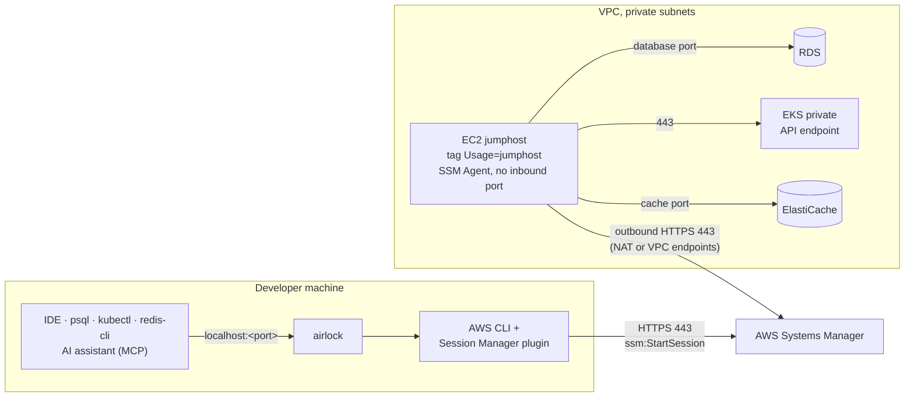

<div align="center">

# 🔐 airlock

**One access point to your private resources, for you and your AI assistants.**

Databases, **EKS** clusters, caches, **DynamoDB** tables, **S3** buckets and **CloudWatch Logs**,
reached through an SSM jumphost, directly, in Docker or through the AWS API. Your tools connect on
`localhost`, with IntelliJ data sources; your AI assistants get guarded, audited **MCP** tools.


[Features](#-features) ·
[Quick start](#-quick-start) ·
[How it works](#-how-it-works) ·
[Documentation](#-documentation) ·
[Contributing](CONTRIBUTING.md)

</div>

---

## ✨ Features

|  |  |
|---|---|
| 🧭 **Guided wizard** | Pick a recent connection, or go resource type → profile → target → review. Search every target of a profile in one list. |
| 🔑 **Passwordless databases** | RDS sign-in with short-lived AWS IAM tokens. Password and AWS Secrets Manager sign-in are available too, with an optional OS keychain. |
| 🪟 **Parallel sessions** | Open as many tunnels as you need, switch between them with a keystroke. Local ports never collide. |
| 🤖 **AI-ready** | Each database, EKS, cache, DynamoDB, S3 and CloudWatch Logs session serves a guarded MCP server and registers it for Claude Code, VS Code, Codex, Cursor and Gemini CLI. |
| 🗄 **Direct databases** | Declare the PostgreSQL, SQL Server, MySQL and MariaDB databases you reach without jumphost, and get the same MCP server, audit log and IDE data source. |
| 🧾 **Audited** | Every MCP call is shown live in the dashboard and written to a daily JSONL audit log. |
| 📦 **Project stacks** | Commit `.airlock.json` with the targets an application needs; `airlock up` opens them all. |
| 🧩 **IDE integration** | Registers the tunnel as an IntelliJ data source in `.idea/dataSources.xml`. |
| 🌍 **Region aware** | Switch region at any time from a searchable list (`paris`, `eu-west`, `japan`…). |
| 👥 **Team settings** | Share one config string with `airlock config export` / `import`. |

## 🚀 Quick start

**1. Install.** No Go needed: the installer downloads the latest release for your machine. The
repository is private, so sign in to GitHub once with the [GitHub CLI](https://cli.github.com)
(`brew install gh` or `winget install GitHub.cli`, then `gh auth login`).

macOS and Linux:

```sh
gh api repos/n2jsoft/airlock/contents/install.sh -H 'Accept: application/vnd.github.raw' | sh
```

Windows (PowerShell 7+):

```pwsh
& ([scriptblock]::Create((gh api repos/n2jsoft/airlock/contents/install.ps1 -H 'Accept: application/vnd.github.raw' | Out-String)))
```

**2. Connect.** Open a new terminal, then:

```sh
airlock                      # launch the wizard
airlock rds my-db 5432       # …or connect directly
```

Then point your tools at `localhost:5432`. That's it. Later, `airlock update` keeps it current.
Something not working? Run `airlock doctor` ([Troubleshooting](docs/troubleshooting.md)).

Installer options, manual install, building from source, updating and uninstalling: see
[Installing and updating](docs/install.md).

**3. Configure, only if needed.** airlock needs no config file: it finds the jumphost of each AWS
account by its tag, `Usage=jumphost` by default. If yours carries another tag, set it once:

```sh
airlock config set aws.jumphostTag Key=Value
```

No jumphost yet? See [Setting up a jumphost](docs/jumphost-setup.md). DynamoDB, S3, CloudWatch
Logs, direct and Docker databases need none.

### Prerequisites

- **AWS CLI v2** and the **[Session Manager plugin](https://docs.aws.amazon.com/systems-manager/latest/userguide/session-manager-working-with-install-plugin.html)**, only for RDS, EKS and ElastiCache tunnels.
- **AWS profiles** (`aws configure` or AWS SSO) with the IAM permissions airlock's calls need,
  including `ssm:StartSession`. airlock signs you in again when a sign-in expires.
- **A running jumphost** for RDS, EKS and ElastiCache, in each account and region you connect to.

The full list is in [Installing and updating](docs/install.md#prerequisites); `airlock doctor`
checks all of it.

## 🛰 How it works

airlock reaches each resource the shortest way it can: through the AWS API for DynamoDB, S3 and
CloudWatch Logs, straight at the host for [direct databases](docs/direct-and-docker.md#direct-databases), on the local
Docker for [containers](docs/direct-and-docker.md#docker-databases-and-caches), and through an SSM jumphost for what sits in
private subnets (RDS, EKS, ElastiCache). Then it serves each connection twice: on `localhost` for
your tools, and as an [MCP server](docs/mcp.md) for your AI assistants.

The jumphost route, with no VPN, no SSH keys and no open ports:



1. **Discover.** airlock finds the target with the AWS APIs (`rds describe-db-instances`,
   `eks describe-cluster`, `elasticache describe-*`) and the jumphost with `ec2 describe-instances`,
   filtered on the jumphost tag.
2. **Tunnel.** It starts `aws ssm start-session` with the `AWS-StartPortForwardingSessionToRemoteHost`
   document. Systems Manager relays the traffic to the jumphost's SSM Agent, which opens the
   connection to the target's endpoint inside the VPC.
3. **Connect.** Your tools connect to `localhost:<port>`.

> [!NOTE]
> Nothing is exposed to the internet. The jumphost has no public IP and no inbound rule; it only
> opens outbound connections to Systems Manager.

## 🧭 Usage

```sh
airlock                              # interactive wizard
airlock rds my-db 5432               # tunnel to an RDS instance on localhost:5432
airlock eks my-cluster 15432         # tunnel to a private EKS API endpoint
airlock elasticache my-cache 6379    # tunnel to an ElastiCache cluster
airlock dynamodb eu-west-3           # DynamoDB tables of a region, for the AI assistant (MCP)
airlock s3                           # S3 buckets of a profile, for the AI assistant (MCP)
airlock logs eu-west-3               # CloudWatch Logs of a region, read-only, for the AI assistant (MCP)
airlock direct legacy-billing        # a direct database declared with airlock connection add
airlock docker pg                    # a database running in a local Docker container
airlock forward search.internal 443  # any host:port the jumphost reaches
airlock exec rds my-db -- npm run migrate   # run a command with the tunnel open
airlock up                           # every target of the project's .airlock.json
airlock doctor                       # check the installation, the config and the AWS profiles
```

`airlock --help` and `airlock <command> --help` list every command and flag.

## 📚 Documentation

| Page | What it covers |
|---|---|
| [Installing and updating](docs/install.md) | Prerequisites, installer options, manual install, build from source, shell completion, `airlock update`, install tracking, `airlock uninstall` |
| [Connecting](docs/connecting.md) | Commands and flags, the wizard, regions, MFA profiles, database sign-in and the OS keychain, EKS, forwarding any host, parallel sessions and their keys, helper commands |
| [Running commands and project stacks](docs/exec-and-stacks.md) | `airlock exec`, `.airlock.json`, `airlock up` and `airlock down` |
| [Direct and Docker databases](docs/direct-and-docker.md) | Databases reached without jumphost, and local Docker databases and caches |
| [AI access with MCP](docs/mcp.md) | The tools of each engine, AI client registration, the MCP gateway, the agent skill, credentials, write access and the audit trail |
| [Configuration](docs/configuration.md) | `config.json` keys, `airlock config`, the Settings screen, language, sharing settings with your team |
| [Daemon mode](docs/daemon.md) | Sessions kept by a background daemon |
| [Organization config](docs/organization-config.md) | Company-wide settings and locks |
| [Setting up a jumphost](docs/jumphost-setup.md) | The EC2 instance airlock tunnels through |
| [Troubleshooting](docs/troubleshooting.md) | `airlock doctor` |
| [Upgrading](docs/upgrading.md) | Files and keys of older versions |

## 🛠 Contributing

Contributions are welcome: see [CONTRIBUTING.md](CONTRIBUTING.md) to build airlock, run the checks
and name your pull request.
