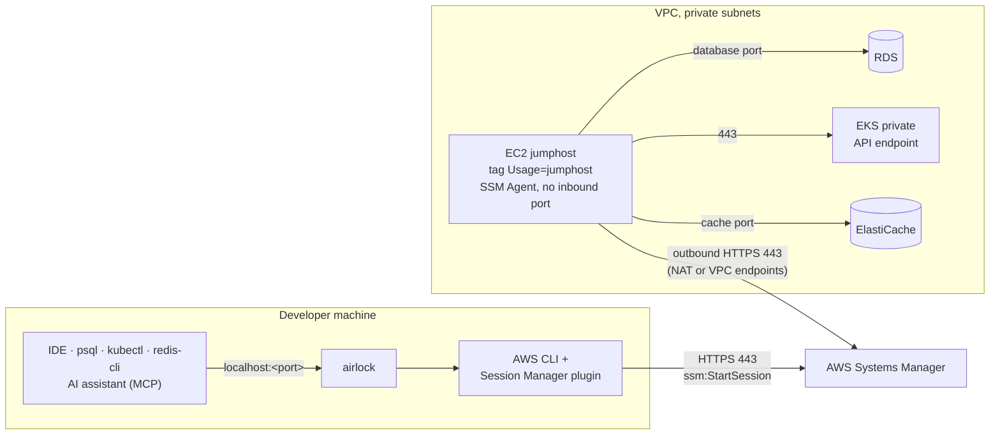

<div align="center">

# 🔐 airlock

**Reach private AWS databases, clusters and caches from your laptop, with no VPN, no SSH keys and no open ports.**

Guided SSM port forwarding to **RDS**, **EKS** and **ElastiCache** through a jumphost, with
IntelliJ data sources and a guarded **MCP server** so AI assistants can query tunneled databases.


[Features](#-features) ·
[Quick start](#-quick-start) ·
[How it works](#-how-it-works) ·
[Usage](#-usage) ·
[AI access (MCP)](#-ai-access-with-mcp) ·
[Configuration](#%EF%B8%8F-configuration) ·
[Jumphost setup](docs/jumphost-setup.md)

</div>

---

## ✨ Features

|  |  |
|---|---|
| 🧭 **Guided wizard** | Pick a recent connection, or go resource type → profile → target → review. Search every target of a profile in one list. |
| 🔑 **Passwordless databases** | RDS sign-in with short-lived AWS IAM tokens. Password sign-in is available too and stays in memory only. |
| 🪟 **Parallel sessions** | Open as many tunnels as you need, switch between them with a keystroke. Local ports never collide. |
| 🤖 **AI-ready** | Each PostgreSQL or SQL Server session serves a read-only MCP server and registers it for Claude Code and VS Code. |
| 🧾 **Audited** | Every MCP query is shown live in the dashboard and written to a daily JSONL audit log. |
| 🧩 **IDE integration** | Registers the tunnel as an IntelliJ data source in `.idea/dataSources.xml`. |
| 🌍 **Region aware** | Switch region at any time from a searchable list (`paris`, `eu-west`, `japan`…). |
| 👥 **Team settings** | Share one config string with `airlock config export` / `import`. |

## 🚀 Quick start

```sh
# 1. Install
make install          # from a checkout, to GOBIN (or GOPATH/bin)

# 2. Launch the wizard
airlock

# …or connect directly
airlock rds my-db 5432
```

Then point your tools at `localhost:5432`. That's it.

<details>
<summary><b>Install with <code>go install</code></b></summary>

```sh
GOPRIVATE=github.com/n2jsoft \
  go install github.com/n2jsoft/airlock/cmd/airlock@latest
```

</details>

### Prerequisites

- **Go 1.27+**
- **AWS CLI v2** and the **[Session Manager plugin](https://docs.aws.amazon.com/systems-manager/latest/userguide/session-manager-working-with-install-plugin.html)** (used by `aws ssm start-session`)
- **AWS credentials and profiles** (`aws configure` or AWS SSO), with IAM permissions for the AWS API calls airlock makes, including `ssm:StartSession`
- **A running jumphost**: an EC2 instance tagged `Usage=jumphost` ([configurable](#%EF%B8%8F-configuration)) in each account and region you connect to. See [Setting up a jumphost](docs/jumphost-setup.md).

## 🛰 How it works



1. **Discover.** airlock finds the target with the AWS APIs (`rds describe-db-instances`,
   `eks describe-cluster`, `elasticache describe-*`) and the jumphost with `ec2 describe-instances`,
   filtered on the jumphost tag.
2. **Tunnel.** It starts `aws ssm start-session` with the `AWS-StartPortForwardingSessionToRemoteHost`
   document. Systems Manager relays the traffic to the jumphost's SSM Agent, which opens the
   connection to the target's endpoint inside the VPC.
3. **Connect.** Your tools connect to `localhost:<port>`.

> [!NOTE]
> Nothing is exposed to the internet. The jumphost has no public IP and no inbound rule; it only
> opens outbound connections to Systems Manager.

## 🧭 Usage

```sh
airlock                              # interactive wizard
airlock rds my-db 5432               # tunnel to an RDS instance on localhost:5432
airlock eks my-cluster 15432         # tunnel to a private EKS API endpoint
airlock elasticache my-cache 6379    # tunnel to an ElastiCache cluster
airlock rds my-db 5432 --db-user app_ro
```

<details>
<summary><b>All flags</b></summary>

| Flag | Meaning |
|---|---|
| `-p`, `--profile` | AWS profile to use (the wizard asks when omitted). `--aws-profile` is an alias. |
| `--region` | AWS region (defaults to `AWS_REGION`, then the profile's region) |
| `--db-user` | Database user for RDS AWS IAM authentication |
| `--no-ide-datasource` | Do not register the connection in `./.idea/dataSources.xml` |
| `--no-mcp` | Do not serve the database MCP server |
| `--mcp-allow-writes` | Let the MCP server modify data |
| `--jumphost-tag` | Tag of the jumphost instance, as `Key=Value` |
| `--read-only-secret-tag` | Tag of the read-only SQL Server secrets, as `Key=Value` |
| `--mcp-server-prefix` | Prefix of the MCP server names |

</details>

### The wizard

The wizard opens on your **recent connections**, most recently used first. Picking one checks that
the target still exists and opens its review step prefilled. Without any recent connection, it opens
on the resource type step.

| Key | Action |
|---|---|
| `/` | Filter recent connections by name, type, profile or region |
| `n` | Start a new connection (resource type → AWS profile → target → review) |
| `s` | Search a target: choose a profile, then pick among all its RDS, EKS and ElastiCache targets in one list |
| `d` | Forget a recent connection |
| `r` | Switch region (on the resource type, target and search steps) |
| `esc` | Go back one step |

- `--profile` and `--region` filter the recent connections and skip the profile question.
- Target types that cannot be listed during a search are named in a warning.
- A recent connection whose profile no longer exists asks for another one. A profile that reaches a
  different AWS account than the one the connection was saved in is refused, since same-named targets
  often exist in several accounts.

### Regions

The wizard never asks for a region up front: the header shows the current one, resolved in this
order:

`--region` → `AWS_REGION` → the profile's configured region → `defaultRegion`

Without any of them, the header shows `region none` and the wizard opens the region list before it
looks for targets. Non-interactive runs fail and name the settings to add. Press `r` to switch region
from a searchable list (by code, city or country). Switching on the target step reloads the targets,
or the search, for the new region.

### Database sign-in

The wizard ends on a **review step** that summarizes the connection. You can edit the local port and
the database user there before connecting.

| Key | Action |
|---|---|
| `tab` | Switch field |
| `space` | Toggle **IAM auth** |
| `enter` | Connect |

- **IAM auth (default).** airlock signs in without a password, generating short-lived AWS IAM
  tokens. The user is prefilled with `--db-user`, then the user saved for that database, then
  `defaultDbUser`.
- **Password.** Turn IAM auth off to enter a user and its password. The password stays in memory
  only: the MCP server uses it, the IntelliJ data source switches to user & password (the IDE asks for
  the password), and the restart command falls back to IAM sign-in.
- The user feeds the connection hints, the IntelliJ data source, the MCP server and the restart
  command. Instances without IAM authentication (SQL Server) only show the port.

> [!TIP]
> airlock remembers each connection per target (AWS account, region, resource type and name), so
> several profiles that reach one account share it. It stores the last profile and local port, plus the
> user, IAM auth setting and MCP write access for databases, in `~/.config/airlock/connections.json`
> (`$XDG_CONFIG_HOME/airlock` when set). A saved port that is already in use falls back to a free
> one, and `--db-user` / `--mcp-allow-writes` still win. **Passwords are never saved.**

### Parallel sessions

While a session runs, press `n` to open another one, with any profile and any resource. Running
sessions stay active, and the start screen marks recent connections that are already open.

| Key | Action |
|---|---|
| `n` | Open another connection |
| `tab` · `←` `→` · `1`–`9` | Switch between sessions |
| `m` | Switch the bottom panel between logs and MCP queries (database sessions) |
| `x` | Stop the selected session, or close it once ended |
| `ctrl+c` | Stop all sessions and quit |

- **Ports never collide.** The suggested port skips ports used by other sessions or other local
  processes (a second `5432` RDS gets `5433`). A busy port requested explicitly is rejected.
- **No duplicates.** Connecting twice to the same target (same type, name, profile and region) is
  refused.

## 🤖 AI access with MCP

For **RDS PostgreSQL** and **SQL Server** sessions, airlock serves an MCP server on `127.0.0.1` for
as long as the session runs, so AI assistants can explore and query the database through the tunnel.

**Tools**

| Tool | Description |
|---|---|
| `list_databases` | List the databases of the instance |
| `list_tables` | List the tables of a database |
| `describe_table` | Show the columns of a table |
| `query` | Run a single read-only `SELECT` / `WITH` (max 1000 rows, 30 s timeout) |
| `execute` | Run a statement that modifies data. **Only with `--mcp-allow-writes`.** |

**Registration.** The server is registered as `<prefix>-<profile>-<instance>` in:

- `.mcp.json` for **Claude Code**, written when `.mcp.json` or `.claude/` exists
- `.vscode/mcp.json` for **VS Code**, written when `.vscode/` exists

It is removed when the session stops. The prefix comes from `mcpServerPrefix` (default `airlock`)
and is not repeated for profiles that already start with it: prefix `team` with profile `team-prod`
gives `team-prod-<instance>`. The dashboard's `MCP` row shows `read-only` or `WRITES ENABLED`, the
server name and its URL. When neither file exists, it also shows the bearer token so you can
configure a client by hand.

> [!IMPORTANT]
> Claude Code reads `.mcp.json` at startup and asks you to approve new project servers. If you open
> a session while Claude Code is already running, use `/mcp` to reconnect.

**Credentials.** Nothing is written to disk.

- **PostgreSQL** uses an IAM token for the chosen database user. Read-only mode relies on that user
  being read-only in the database, in addition to the query guard.
- **SQL Server** uses the read-only secrets of the instance tagged with `readOnlySecretTag`, one per
  database. Without that tag, SQL Server read-only access is off.

**Write access.** `--mcp-allow-writes`, or the `MCP` toggle on the review step, adds the destructive
`execute` tool. PostgreSQL still signs in as the chosen database user, so pick a user that is allowed
to write: its grants decide what can change. SQL Server has no IAM sign-in and switches to the RDS
master user secret (administrators only). `--no-mcp` disables the server entirely.

### Audit trail

Every MCP tool call is recorded. In the dashboard, press `m` on a database session to see its MCP
queries: time, tool, database, rows, duration, full SQL and errors, including statements the read-only
guard rejected (the last 500 per session).

The calls of every session are also appended to a daily audit log, one JSON object per line:

```
~/.config/airlock/logs/mcp-queries-YYYY-MM-DD.jsonl    # $XDG_CONFIG_HOME/airlock/logs when set
```

```sh
jq -r 'select(.sql) | "\(.time) \(.server) \(.sql)"' ~/.config/airlock/logs/mcp-queries-*.jsonl
```

Result rows are never logged. The files are readable by your user only, since statements may
contain sensitive values.

## ⚙️ Configuration

Settings live in `~/.config/airlock/config.json` (`$XDG_CONFIG_HOME/airlock` when set,
`%AppData%\airlock` on Windows). Every key is optional and flags take precedence over the file. An
unknown key or a malformed value is an error that names the file.

| Key | Flag | Default | Meaning |
|---|---|---|---|
| `jumphostTag` | `--jumphost-tag` | `Usage=jumphost` | Tag (`Key=Value`) of the running SSM jumphost EC2 instance |
| `defaultDbUser` | `--db-user` | none (asked) | Database user signing in with AWS IAM |
| `readOnlySecretTag` | `--read-only-secret-tag` | none (SQL Server read-only MCP off) | Tag (`Key=Value`) of the per-database read-only Secrets Manager secrets |
| `mcpServerPrefix` | `--mcp-server-prefix` | `airlock` | Start of the MCP server names |
| `defaultRegion` | `--region` | none (asked) | Region used after `AWS_REGION` and the profile's region |

### Commands

```sh
airlock config show              # every setting, its value and where it comes from (--json for effective values)
airlock config path              # print the file location
airlock config init              # write every key with its default and explain each one (--force keeps a .bak)
airlock config set <key> <value> # validate and write one key, e.g. jumphostTag Env=bastion
airlock config unset <key>       # remove a key so its default applies again
```

The file is rewritten indented, with keys in a fixed order. Errors caused by a setting name it. For
example, a jumphost not found with the configured tag points to `jumphostTag`, `airlock config show`
and `--jumphost-tag`.

### Sharing settings with your team

A team usually sets the same few keys, for example:

```json
{
  "defaultRegion": "eu-west-1",
  "defaultDbUser": "app_ro",
  "readOnlySecretTag": "Role=read-only",
  "mcpServerPrefix": "team"
}
```

```sh
airlock config export            # prints the keys set in your file as one string: airlock1:…
airlock config import <string>   # shows what changes, then asks before writing
```

`import` lists every key it adds (`+`), changes (`~`) or keeps (`=`), with what each key does. `--yes`
skips the question. Keys in your file that the string does not set are kept, unless you pass
`--replace`, which removes them (`-`).

> [!WARNING]
> The string is deliberately not human-readable, so review the list before you answer `y`. Its
> checksum only catches a damaged copy and paste; it does not prove who made the string. Keep your
> real preset internal: set it once, then share it with `airlock config export` rather than in a
> public document.

## 🛠 Development

```sh
make run                     # run the CLI
make build                   # build to bin/airlock
make install                 # install to GOBIN (make uninstall to remove)
make fmt vet lint test       # format, vet, lint and test
```

See [.claude/CLAUDE.md](.claude/CLAUDE.md) for the architecture and contribution conventions.
