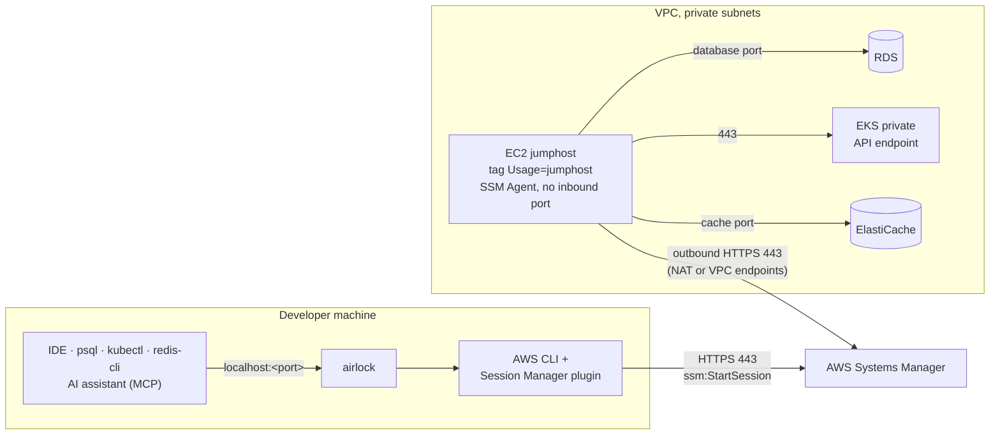

<div align="center">

# 🔐 airlock

**Reach private AWS databases, clusters and caches from your laptop, with no VPN, no SSH keys and no open ports.**

Guided SSM port forwarding to **RDS**, **EKS** and **ElastiCache** through a jumphost, with
IntelliJ data sources and a guarded **MCP server** so AI assistants can query tunneled databases.


[Features](#-features) ·
[Quick start](#-quick-start) ·
[How it works](#-how-it-works) ·
[Usage](#-usage) ·
[AI access (MCP)](#-ai-access-with-mcp) ·
[Configuration](#%EF%B8%8F-configuration) ·
[Jumphost setup](docs/jumphost-setup.md)

</div>

---

## ✨ Features

|  |  |
|---|---|
| 🧭 **Guided wizard** | Pick a recent connection, or go resource type → profile → target → review. Search every target of a profile in one list. |
| 🔑 **Passwordless databases** | RDS sign-in with short-lived AWS IAM tokens. Password and AWS Secrets Manager sign-in are available too, with an optional OS keychain. |
| 🪟 **Parallel sessions** | Open as many tunnels as you need, switch between them with a keystroke. Local ports never collide. |
| 🤖 **AI-ready** | Each PostgreSQL or SQL Server session serves a read-only MCP server and registers it for Claude Code and VS Code. |
| 🧾 **Audited** | Every MCP query is shown live in the dashboard and written to a daily JSONL audit log. |
| 🧩 **IDE integration** | Registers the tunnel as an IntelliJ data source in `.idea/dataSources.xml`. |
| 🌍 **Region aware** | Switch region at any time from a searchable list (`paris`, `eu-west`, `japan`…). |
| 👥 **Team settings** | Share one config string with `airlock config export` / `import`. |

## 🚀 Quick start

```sh
# 1. Install
make install          # from a checkout, to GOBIN (or GOPATH/bin)

# 2. Launch the wizard
airlock

# …or connect directly
airlock rds my-db 5432
```

Then point your tools at `localhost:5432`. That's it.

<details>
<summary><b>Install with <code>go install</code></b></summary>

```sh
GOPRIVATE=github.com/n2jsoft \
  go install github.com/n2jsoft/airlock/cmd/airlock@latest
```

</details>

### Prerequisites

- **Go 1.27+**
- **AWS CLI v2** and the **[Session Manager plugin](https://docs.aws.amazon.com/systems-manager/latest/userguide/session-manager-working-with-install-plugin.html)** (used by `aws ssm start-session`)
- **AWS credentials and profiles** (`aws configure` or AWS SSO), with IAM permissions for the AWS API calls airlock makes, including `ssm:StartSession`.
  When a profile's credentials are missing or expired, airlock runs `aws sso login` for you: the
  dashboard steps aside while it runs, so the browser prompt, URL and code stay readable, then comes back.
- **A running jumphost**: an EC2 instance tagged `Usage=jumphost` ([configurable](#%EF%B8%8F-configuration)) in each account and region you connect to. See [Setting up a jumphost](docs/jumphost-setup.md).

## 🛰 How it works



1. **Discover.** airlock finds the target with the AWS APIs (`rds describe-db-instances`,
   `eks describe-cluster`, `elasticache describe-*`) and the jumphost with `ec2 describe-instances`,
   filtered on the jumphost tag.
2. **Tunnel.** It starts `aws ssm start-session` with the `AWS-StartPortForwardingSessionToRemoteHost`
   document. Systems Manager relays the traffic to the jumphost's SSM Agent, which opens the
   connection to the target's endpoint inside the VPC.
3. **Connect.** Your tools connect to `localhost:<port>`.

> [!NOTE]
> Nothing is exposed to the internet. The jumphost has no public IP and no inbound rule; it only
> opens outbound connections to Systems Manager.

## 🧭 Usage

```sh
airlock                              # interactive wizard
airlock rds my-db 5432               # tunnel to an RDS instance on localhost:5432
airlock eks my-cluster 15432         # tunnel to a private EKS API endpoint
airlock elasticache my-cache 6379    # tunnel to an ElastiCache cluster
airlock rds my-db 5432 --db-user app_ro
```

<details>
<summary><b>All flags</b></summary>

| Flag | Meaning |
|---|---|
| `-p`, `--profile` | AWS profile to use (the wizard asks when omitted). `--aws-profile` is an alias. |
| `--region` | AWS region (defaults to `AWS_REGION`, then the profile's region) |
| `--db-user` | Database user for RDS AWS IAM authentication |
| `--db-secret` | Secrets Manager secret (ARN or name) holding the RDS password |
| `--no-ide-datasource` | Do not register the connection in `./.idea/dataSources.xml` |
| `--no-mcp` | Do not serve the database MCP server |
| `--mcp-allow-writes` | Let the MCP server modify data |
| `--jumphost-tag` | Tag of the jumphost instance, as `Key=Value` |
| `--read-only-secret-tag` | Tag of the read-only SQL Server secrets, as `Key=Value` |
| `--mcp-server-prefix` | Prefix of the MCP server names |

</details>

<details>
<summary><b>Shell completion</b></summary>

`airlock completion bash|zsh|fish|powershell` prints the completion script. It completes the
resource type, the targets you connected to (filtered by `--profile` and `--region` when given),
the local port they last used, the AWS profiles and the regions, all without calling AWS.

```sh
airlock completion zsh > "${fpath[1]}/_airlock"      # zsh
airlock completion bash > ~/.local/share/bash-completion/completions/airlock   # bash
airlock completion fish > ~/.config/fish/completions/airlock.fish              # fish
```

</details>

### The wizard

The wizard opens on your **recent connections**, most recently used first. Picking one checks that
the target still exists and opens its review step prefilled. Without any recent connection, it opens
on the resource type step.

| Key | Action |
|---|---|
| any letter · `/` | Filter recent connections by name, type, profile or region: type right away, or press `/` first when the name starts with a shortcut letter (`n`, `s`, `d`, `q`, `j`, `k`…) |
| `n` | Start a new connection (resource type → AWS profile → target → review) |
| `s` | Search a target: choose a profile, then pick among all its RDS, EKS and ElastiCache targets in one list |
| `d` | Forget a recent connection |
| `r` | Switch region (on the resource type, target and search steps) |
| `esc` | Go back one step (from the first step of a wizard opened with `n`, back to the sessions); while AWS answers, cancel |
| `?` | List the keys of the current step |

- `--profile` and `--region` filter the recent connections and skip the profile question.
- Target types that cannot be listed during a search are named in a warning.
- A recent connection whose profile no longer exists asks for another one. A profile that reaches a
  different AWS account than the one the connection was saved in is refused, since same-named targets
  often exist in several accounts.

### Regions

The wizard never asks for a region up front: the header shows the current one, resolved in this
order:

`--region` → `AWS_REGION` → the profile's configured region → `defaultRegion`

Without any of them, the header shows `region none` and the wizard opens the region list before it
looks for targets. Non-interactive runs fail and name the settings to add. Press `r` to switch region
from a searchable list (by code, city or country). Switching on the target step reloads the targets,
or the search, for the new region.

### Database sign-in

The wizard ends on a **review step** that summarizes the connection. You can edit the local port,
the sign-in method and the database user there before connecting.

| Key | Action |
|---|---|
| `tab` | Switch field |
| `←` `→` · `space` | Change the **Sign-in** method |
| `enter` | Connect (on the Secret field: search the secrets) |

The **Sign-in** selector offers up to four methods, depending on the target:

| Method | Offered when |
|---|---|
| **IAM token** | The instance has IAM authentication enabled. Default when offered. |
| **Auto** | SQL Server only: the tagged read-only secrets, or the master user secret with MCP writes. |
| **Password** | PostgreSQL, Aurora PostgreSQL and SQL Server targets, with the MCP server on (no `--no-mcp`). |
| **Secrets Manager** | Same as Password. |

Password and Secrets Manager are offered only where airlock itself uses the credentials, that is for
the MCP server. Elsewhere (MySQL, or `--no-mcp`) only IAM token is shown when enabled, and your IDE
asks for the password as before.

- **IAM token.** airlock signs in without a password, generating short-lived AWS IAM tokens. The user
  is prefilled with `--db-user`, then the user saved for that database, then `defaultDbUser`.
- **Password.** Enter a user and its password. It stays in memory for the MCP server; the IntelliJ
  data source switches to user & password (the IDE asks for the password), and the restart command
  falls back to IAM sign-in. The **Remember** toggle (off by default) stores the password in the OS
  keychain, and the next connection prefills it, masked.
- **Secrets Manager.** Press `enter` on the **Secret** field to search every secret of the account
  and region. The secrets linked to the instance come first: tagged `DBInstanceArn`, the RDS master
  user secret, or a name containing the instance name. The secret is either RDS JSON (`username` and
  `password`) or plain text (then fill the **User** field). It is read before the tunnel opens, so an
  unreadable secret fails fast, and the MCP server reads it again after the database rejects the
  password, which covers rotation. From the CLI, `--db-secret <arn|name>` selects it and wins over the
  saved choice; the restart command of such a session carries `--db-secret`.
- The user feeds the connection hints, the IntelliJ data source, the MCP server and the restart
  command. Instances without IAM authentication or MCP support only show the port.

```sh
airlock rds my-db 5432 --db-secret prod/app-user
```

#### The OS keychain

With **Remember**, the password is stored under the service `airlock` in the macOS Keychain, the
Windows Credential Manager or the Linux Secret Service. It is forgotten when you turn **Remember**
off, when the database rejects it, or when you forget the connection from the recent list (`d`).
Without an OS keychain (a headless Linux, for example), the toggle is not offered and the password is
asked every time. A keychain failure never blocks the connection: it appears as a `Warning:` line in
the session log.

> [!WARNING]
> On macOS, airlock reaches the Keychain through `/usr/bin/security`, so the item trusts that tool,
> not airlock. Another process running as the same user can read it without a prompt. It is safer
> than a plaintext file, but it is not per-application isolation.

#### IAM permissions

Secrets Manager sign-in needs `secretsmanager:ListSecrets` and `secretsmanager:GetSecretValue`, plus
`kms:Decrypt` when the secret uses a customer-managed KMS key.

> [!TIP]
> airlock remembers each connection per target (AWS account, region, resource type and name), so
> several profiles that reach one account share it. It stores the last profile and local port, plus the
> user, sign-in method, secret ARN, keychain flag and MCP write access for databases, in
> `~/.config/airlock/connections.json` (`$XDG_CONFIG_HOME/airlock` when set), as `sign_in`,
> `db_secret_arn` and `password_in_keychain`. A saved port that is already in use falls back to a free
> one, and `--db-user` / `--db-secret` / `--mcp-allow-writes` still win. **`connections.json` never
> holds a password.**

### Kubernetes (EKS)

Each EKS session gets its own kubeconfig, written to `~/.config/airlock/kube/`
(`$XDG_CONFIG_HOME/airlock/kube` when set) and removed when the session stops. Its only context
points at the tunnel, checks the certificate against the real cluster endpoint (`tls-server-name`)
and signs in with `aws eks get-token`, with the session's profile and region. Your own
`~/.kube/config` is never touched. A kubeconfig left by an airlock that was killed is removed at
the next start; those of another running airlock are kept.

```sh
export KUBECONFIG=~/.config/airlock/kube/airlock-<profile>-<region>-<cluster>.json
kubectl get namespaces    # k9s, Lens and other clients read it too
```

The session log shows the exact path, and the dashboard's `Kube` row the `KUBECONFIG` value. To
keep your own context of the cluster instead, point it at the tunnel:
`kubectl --server https://localhost:<port> --tls-server-name <endpoint host> get namespaces`.

### Parallel sessions

While a session runs, press `n` to open another one, with any profile and any resource. Running
sessions stay active, and the start screen marks recent connections that are already open: `enter`
on one of them switches to its session instead of opening a second one.

| Key | Action |
|---|---|
| `n` | Open another connection |
| `tab` · `←` `→` · `1`–`9` | Switch between sessions |
| `m` | Switch the bottom panel between logs and MCP queries (database sessions) |
| `↑` `↓` · `pgup` `pgdn` | Scroll the logs; scrolling up pauses them |
| `g` · `home` / `G` · `end` | Jump to the start of the logs / back to the live tail |
| `x` | Stop the selected session, or close it once ended |
| `r` | Restart the selected ended session: same target, local port and sign-in |
| `c` | Copy the local address, the IAM token command, the reconnect command, the `KUBECONFIG` export or the last MCP query |
| `esc` | Cancel a connection being prepared |
| `?` | List every key |
| `q` · `ctrl+c` | Stop all sessions and quit, after a confirmation (`y` / `n`, or `ctrl+c` again) |

`c` copies to the system clipboard (`pbcopy`, `xclip`, `wl-copy`…). Over SSH, or without such a
tool, it asks the terminal to copy through OSC 52, which most terminals support (iTerm2, kitty,
WezTerm, Ghostty, Windows Terminal, tmux with `set-clipboard on`), but not macOS Terminal.

A session that ends, on its own or with `x`, stays in the dashboard with its logs until you close it,
restart it or quit.

**Automatic reconnection.** A session that worked and then drops on its own (SSM idle timeout,
network loss, laptop sleep) reconnects in the background, in the same slot, on the same local port
and with the same sign-in, so your tools keep working. Its card shows `Retry in 5s`, then
`Reconnecting`. Attempts wait 2 s, 5 s, 15 s, 30 s, then 1 min, and stop after the fifth in a row;
a session that then runs for a minute gets fresh attempts. `r` reconnects now, `x` closes the
session instead.

- A session stopped with `x`, or that never listened (its settings are likely wrong), is not
  reconnected.
- A reconnection never signs in: nobody may be there to answer the browser. When the AWS
  credentials have expired, it stops and asks you to press `r`, which signs in again.

- **Ports never collide.** The suggested port skips ports used by other sessions or other local
  processes (a second `5432` RDS gets `5433`). A busy port requested explicitly is rejected.
- **No duplicates.** Connecting twice to the same target (same type, name, profile and region) is
  refused.

## 🤖 AI access with MCP

For **RDS PostgreSQL** and **SQL Server** sessions, airlock serves an MCP server on `127.0.0.1` for
as long as the session runs, so AI assistants can explore and query the database through the tunnel.

**Tools**

| Tool | Description |
|---|---|
| `list_databases` | List the databases of the instance |
| `list_tables` | List the tables of a database |
| `describe_table` | Show the columns of a table |
| `query` | Run a single read-only `SELECT` / `WITH` (max 1000 rows, 30 s timeout) |
| `execute` | Run a statement that modifies data. **Only with `--mcp-allow-writes`.** |

**Registration.** The server is registered as `<prefix>-<profile>-<instance>` in:

- `.mcp.json` for **Claude Code**, written when `.mcp.json` or `.claude/` exists
- `.vscode/mcp.json` for **VS Code**, written when `.vscode/` exists

It is removed when the session stops. The prefix comes from `mcpServerPrefix` (default `airlock`)
and is not repeated for profiles that already start with it: prefix `team` with profile `team-prod`
gives `team-prod-<instance>`. A red `WRITES` badge flags the sessions whose server can modify
data, in the sidebar and the compact pills. The dashboard's `MCP` row shows `read-only` or
`WRITES ENABLED`, the server name and its URL. When neither file exists, it also shows the bearer token so you can
configure a client by hand.

> [!IMPORTANT]
> Claude Code reads `.mcp.json` at startup and asks you to approve new project servers. If you open
> a session while Claude Code is already running, use `/mcp` to reconnect.

**Credentials.** Nothing is written to disk.

- **PostgreSQL** uses an IAM token for the chosen database user. Read-only mode relies on that user
  being read-only in the database, in addition to the query guard.
- **SQL Server** uses the read-only secrets of the instance tagged with `readOnlySecretTag`, one per
  database. Without that tag, SQL Server read-only access is off.

**Write access.** `--mcp-allow-writes`, or the `MCP` toggle on the review step, adds the destructive
`execute` tool. PostgreSQL still signs in as the chosen database user, so pick a user that is allowed
to write: its grants decide what can change. SQL Server has no IAM sign-in and switches to the RDS
master user secret (administrators only). `--no-mcp` disables the server entirely.

### Audit trail

Every MCP tool call is recorded. In the dashboard, press `m` on a database session to see its MCP
queries: time, tool, database, rows, duration, full SQL and errors, including statements the read-only
guard rejected (the last 500 per session).

The calls of every session are also appended to a daily audit log, one JSON object per line:

```
~/.config/airlock/logs/mcp-queries-YYYY-MM-DD.jsonl    # $XDG_CONFIG_HOME/airlock/logs when set
```

```sh
jq -r 'select(.sql) | "\(.time) \(.server) \(.sql)"' ~/.config/airlock/logs/mcp-queries-*.jsonl
```

Result rows are never logged. The files are readable by your user only, since statements may
contain sensitive values.

## ⚙️ Configuration

Settings live in `~/.config/airlock/config.json` (`$XDG_CONFIG_HOME/airlock` when set,
`%AppData%\airlock` on Windows). Every key is optional and flags take precedence over the file. An
unknown key or a malformed value is an error that names the file.

| Key | Flag | Default | Meaning |
|---|---|---|---|
| `jumphostTag` | `--jumphost-tag` | `Usage=jumphost` | Tag (`Key=Value`) of the running SSM jumphost EC2 instance |
| `defaultDbUser` | `--db-user` | none (asked) | Database user signing in with AWS IAM |
| `readOnlySecretTag` | `--read-only-secret-tag` | none (SQL Server read-only MCP off) | Tag (`Key=Value`) of the per-database read-only Secrets Manager secrets |
| `mcpServerPrefix` | `--mcp-server-prefix` | `airlock` | Start of the MCP server names |
| `defaultRegion` | `--region` | none (asked) | Region used after `AWS_REGION` and the profile's region |
| `productionProfiles` | none | none | Comma-separated patterns (`*` wildcard, any case) of the AWS profiles flagged as production, e.g. `*prod*,*-live` |

Profiles matching `productionProfiles` get an orange `PROD` badge everywhere they appear: the
wizard header, profile list, recent connections and review step, and the dashboard's session
cards, pills and details, whose borders turn orange. Naming conventions differ between teams, so
no profile is flagged until you set it, typically in your team's shared settings.

### Commands

```sh
airlock config show              # every setting, its value and where it comes from (--json for effective values)
airlock config path              # print the file location
airlock config init              # write every key with its default and explain each one (--force keeps a .bak)
airlock config set <key> <value> # validate and write one key, e.g. jumphostTag Env=bastion
airlock config unset <key>       # remove a key so its default applies again
```

The file is rewritten indented, with keys in a fixed order. Errors caused by a setting name it. For
example, a jumphost not found with the configured tag points to `jumphostTag`, `airlock config show`
and `--jumphost-tag`.

### Sharing settings with your team

A team usually sets the same few keys, for example:

```json
{
  "defaultRegion": "eu-west-1",
  "defaultDbUser": "app_ro",
  "readOnlySecretTag": "Role=read-only",
  "mcpServerPrefix": "team",
  "productionProfiles": "*prod*"
}
```

```sh
airlock config export            # prints the keys set in your file as one string: airlock1:…
airlock config import <string>   # shows what changes, then asks before writing
```

`import` lists every key it adds (`+`), changes (`~`) or keeps (`=`), with what each key does. `--yes`
skips the question. Keys in your file that the string does not set are kept, unless you pass
`--replace`, which removes them (`-`).

> [!WARNING]
> The string is deliberately not human-readable, so review the list before you answer `y`. Its
> checksum only catches a damaged copy and paste; it does not prove who made the string. Keep your
> real preset internal: set it once, then share it with `airlock config export` rather than in a
> public document.

## 🛠 Development

```sh
make run                     # run the CLI
make build                   # build to bin/airlock
make install                 # install to GOBIN (make uninstall to remove)
make fmt vet lint test       # format, vet, lint and test
```

See [.claude/CLAUDE.md](.claude/CLAUDE.md) for the architecture and contribution conventions.
